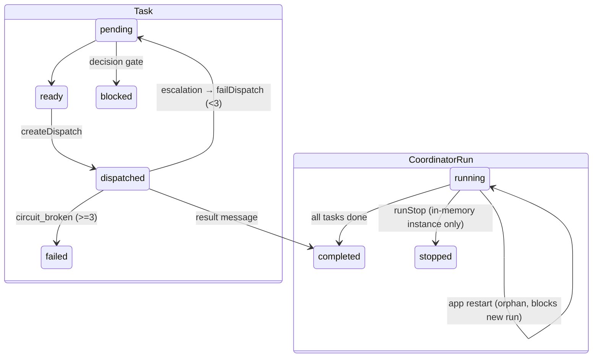
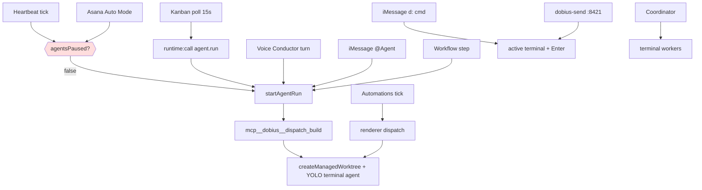
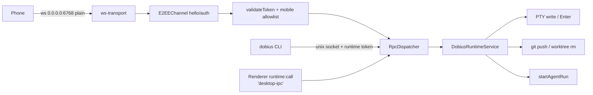

# Dobius+ V2 — Architecture Map

Date: 2026-09-23. Branch: `stabilize/iris-20260923`. Purpose: the system map that the 123-bug stabilization program (see `BUG-LIST-123.md`, `BUG-MATRIX.md`) plans and codes against.

Path conventions: `M/` = `dobius/src/main/`, `R/` = `dobius/src/renderer/src/`, `S/` = `dobius/src/shared/`, `P/` = `dobius/src/preload/`. Repo root is `/Users/bayou/Projects (Code)/Dobius/dobius-plus`. Line numbers were read on 2026-09-23 from the main checkout (branch `fix/channel-cost`, HEAD `7196dd82 chore(release): bump version to 2.0.0`). Every claim below is traced to a line I read; anything else is marked **UNVERIFIED**. Nothing was executed; this is static analysis.

Confidence legend: plain text = read in source this session; *(matrix)* = consistent with BUG-MATRIX row, spot-checked; **UNVERIFIED** = not confirmed.

---

## 0. Component map

```mermaid
flowchart LR
  subgraph Outside["Outside the app"]
    Phone[Phone / web client]
    iMsg[iMessage chat.db]
    Asana[Asana API]
    EL[ElevenLabs]
    Anthropic[Claude SDK / codex CLI]
    ADAM[ADAM service :8791]
    CLI[dobius / dobius-send CLIs]
    Hooks[Agent CLI hooks]
  end
  subgraph Main["Electron main (M/)"]
    IDX[index.ts startup]
    RT[DobiusRuntimeService]
    RPC[Runtime RPC server<br/>unix socket + ws 0.0.0.0:6768]
    IPC[ipc/* handlers]
    AR[agents/agent-runner]
    TOOLS[mcp__dobius__* tool server]
    HB[heartbeats]
    AAM[Asana Auto Mode]
    VC[Voice Conductor]
    JV[Jarvis]
    IMB[iMessage bridge]
    DS[dispatch server 127.0.0.1:8421]
    AHS[agent hook server 127.0.0.1:0]
    ORCH[orchestration coordinator + SQLite]
    AUTO[automations service]
    PERS[persistence Store<br/>dobius-data.json]
    DAEMON[terminal daemon<br/>node-pty]
    RELAY[Communications relay 127.0.0.1:3300]
    JOUR[agent-run-event-journal]
  end
  subgraph Renderer["Renderer (R/)"]
    APP[App.tsx activeView]
    KB[Kanban BoardDispatchGate]
    COMMS[Communications client]
    JVUI[Jarvis orb / self-edit windows]
  end
  Phone -->|E2EE ws| RPC
  CLI --> DS
  CLI -->|unix socket| RPC
  Hooks --> AHS
  iMsg --> IMB
  Asana --> AAM
  APP -->|runtime:call| IPC --> RPC
  KB -->|agent.run via runtime:call| AR
  COMMS --> RELAY
  RPC --> RT
  IMB -->|d: commands| RT
  IMB -->|@Agent| AR
  DS -->|/tabSend| RT
  VC --> AR
  JV -->|run_dobius| CLI
  JVUI -->|ElevenLabs convai tools| JV
  JV --> EL
  JV --> ADAM
  HB --> AR
  AAM --> AR
  AR --> TOOLS -->|dispatch_build| RT
  AR --> Anthropic
  AR --> JOUR --> ADAM
  RT --> DAEMON
  RT --> ORCH
  AUTO --> APP
  IPC --> PERS
```

---

## 1. Desktop app (startup, preload, renderer, IPC)

### 1.1 Main-process startup order (`M/index.ts`)

Two phases: module-load (before `whenReady`) and `app.whenReady()` (:1628).

Phase A — module load, gated on the single-instance lock (:573):
1. `initDataPath()` (:584) captures the userData path **before** `app.setName()` changes it (comment :581-583; `M/persistence.ts:319-323` stores `_userDataDir` and `dobius-data.json`). Then `initStatsPath()`, `initClaudeUsagePath()`, `initCodexUsagePath()`, `initOpenCodeUsagePath()` (:587-590). This is the "cached" root; everything that later calls `app.getPath('userData')` lazily is the second root (bug #53; `getCanonicalUserDataPath` fallback at `persistence.ts:446-450`).
2. `installRelocatedNodePtyNativeRuntime()`, `CrashReportStore.fromUserData()`, GPU fallback, `ensureVirtualDisplayForHeadlessServe` (:592-608).
3. IPC `app:awaitFirstWindowStartupServices` (:611).

Phase B — `app.whenReady()` (:1628), in order:
1. Fire-and-forget ADAM **journal replay** `replayRecentAgentRunJournalEvents()` (:1630-1632) — before the store exists.
2. `app.setName(...)` (:1634), `store = new Store()` (:1636), `migrateLegacyDobiusConfig(store)` (:1637; reads V1 `config.json` from the same userData, `M/migrate-legacy-dobius-config.ts:46`).
3. Proxy settings, browser sessions, `AgentAwakeService`, `ExternalBackupService` (:1647-1690).
4. `initTelemetry` (no-op: `TELEMETRY_ENABLED = false`, `M/telemetry/client.ts:48`), `initObservability`, cohort classifiers (:1707-1722).
5. Stores/services: `StatsCollector`, usage stores, `RateLimitService`, Codex/Claude runtime-home + auth + account services, `KeybindingService` (:1723-1790).
6. `runtimeService = new DobiusRuntimeService(store, stats, …)` (:1792) — the central object every RPC/IPC/bridge goes through.
7. `automations = new AutomationService(store, …)` (:1810); headless dispatcher only in serve mode (:1816).
8. `startImessageBridge(runtimeService, prepareClaudeLaunch)` (:1918) — section 8.
9. `startDobiusCli(runtimeService)` (:1921) — localhost dispatch server :8421 (section 7.4).
10. `voiceConductorImessageHandle = process.env.DOBIUS_IMESSAGE_HANDLE ?? ''` (:1925), `syncVoiceConductorFromSettings(...)` (:1926) and again on every settings change (:1927-1929).
11. Prompts handlers, `AgentBrowserBridge`, `EmulatorBridge` (:1931-1940); menu + i18n (:1981-1985).
12. `migrateMobilePairingDataToCanonicalUserDataPath(app.getPath('userData'))` (:2089); `runtimeRpc = new DobiusRuntimeRpcServer({ runtime, userDataPath: getCanonicalUserDataPath(), enableWebSocket: true, … })` (:2090-2101); dev pins ws port 6769, E2E 0, packaged default 6768 (:2075-2083). `registerMobileHandlers(runtimeRpc)` (:2103).
13. Desktop: `startDesktopFirstWindowStartupServices()` (:2106) → daemon PTY provider + agent hook server (:626-668). Serve mode: `startServeAgentHookServer()`, `registerHeadlessPtyRuntime`, offscreen browser backend, `runtimeRpc.start()` (:2110-2135).
14. `openMainWindow()` in parallel with `runtimeRpc.start()` (:2190-2195). `openMainWindow` → `createMainWindow` (:795) → `registerCoreHandlers(...)` (:912) → `automations.start()` (:941) → `attachMainWindowServices(...)` (:942; `M/window/attach-main-window-services.ts:71`, which also registers Jarvis IPC at :147 and defers updater setup at :155-165).
15. Agent timers start inside `registerCoreHandlers` → `registerAgentsHandlers` (`M/ipc/register-core-handlers.ts:157`) → `startAgentHeartbeats` and `startAsanaAutoMode` (`M/ipc/agents.ts:74-75`). Kanban board dispatch deliberately does NOT start in main (comment `M/ipc/agents.ts:76-81`).

Quit: `before-quit` (:2223) disposes awake/backup/rate-limit services; `will-quit` (:2244) stops iMessage bridge, dobius-cli server, automations, hook server, `stats.flush()`, then the two-pass daemon disconnect for the checkpoint flush (comment :2239-2243).

### 1.2 Preload (`P/index.ts`)
One 4,523-line file exposing `window.electron` and `window.api` (`P/index.ts:4507-4508`). `api` has 79 namespaces (`agents` :1119, `vertexTasks` :2040, `runtime` :3934, `mobile` :4269, `speech` :4370, `jarvis` :4444, …) and 647 `ipcRenderer.invoke` calls. The single most powerful entry is `api.runtime.call({ method, params })` (:3938-3939) → IPC `runtime:call` (1.5).

### 1.3 Renderer entry and page routing
`R/main.tsx:45-49` picks the root from `location.hash` in priority order: torn-off terminal → floating phone → Jarvis orb `#/orb` (`OrbView`, :107-118) → self-edit review window (`SelfEditView`, :95-106) → main `<App/>` under a splash (:119-146). In `App.tsx` the page is the Zustand field `activeView` (`R/App.tsx:76,142,152`; set by `SidebarNav.tsx:40`, `DobiusTitlebarButtons.tsx:43`); pages lazy-load from `R/app-lazy-pages.ts` (Landing, CommandCenterPage, HomePage, TaskPage, AutomationsPage, Settings, SkillsPage, AgentsPage, BuzzPage = Communications, WorkspaceSpacePage, MobilePage, Terminal). `App.tsx:493` mounts `<BoardDispatchGate enabled={settings?.vertexAutoModeEnabled === true} />` (section 5.3). `R/hooks/useAutomationDispatchEvents.ts:48` is the renderer half of automations dispatch (section 5.5).

### 1.4 IPC registration (`M/ipc/`)
`registerCoreHandlers` (`M/ipc/register-core-handlers.ts:100-249`) runs once per main window (guard :121-141) and registers ~60 handler groups in a fixed order (:143-248): app, cli, preflight, usage, accounts, agent hooks, agent trust, vertex tasks, GitHub/GitLab/Linear/Jira/Asana, **agents** (:157-171), iMessage bridge (:172), settings (:190), automations (:194-196), filesystem (:214-218), **runtime** (:220), communications gateway + relay start (:221-226; Buzz relay at 127.0.0.1:3300, `M/communications/relay/relay-server.ts:2,406`), runtime environments, ephemeral VM, AI vault, native chat, clipboard, updater, speech (:227-248). Before the once-guard it re-wires two global registries every call: `setRepoLister` and `setBuildDispatcher` (:126-141); the latter backs the `mcp__dobius__dispatch_build` tool (3.3).

### 1.5 The `runtime:call` passthrough (`M/ipc/runtime.ts:33-45`)
```ts
ipcMain.handle('runtime:call', async (_event, args) =>
  new RpcDispatcher({ runtime }).dispatch({ id: 'desktop-ipc', authToken: 'desktop-ipc', method: args.method, params: args.params }))
```
`RpcDispatcher.dispatch` (`M/runtime/rpc/dispatcher.ts:45-80`) looks the method up in the full registry (`ALL_RPC_METHODS`, :41), parses params and calls the handler; it contains **no** authToken or scope check (grep for `authToken|scope|allowlist` in dispatcher.ts: none). Token checks live only in the socket layer (`M/runtime/runtime-rpc.ts:895-905` for the unix socket, :941-965 for WS). So any renderer code — including the embedded Communications client — can invoke any RPC method (`agent.run`, `terminal.send`, `worktree.rm`, `git.push`, `orchestration.run`, …) with the literal `'desktop-ipc'` token (bug #21). No `event.sender` check either (contrast `runtime:syncWindowGraph` :20-27).

---

## 2. Data layer

### 2.1 Roots
- **Electron userData** `~/Library/Application Support/dobius-plus/` (package name; `app.setName('Dobius+')` runs after `initDataPath`, `M/index.ts:581-584`). Dev builds use `dobius-dev` (comment `M/index.ts:582`). Two resolution styles coexist: cached (`persistence.ts:319-323`, `getCanonicalUserDataPath` :446) vs lazy `app.getPath('userData')` used by every small store (e.g. `agent-runs-store.ts:12`, `agents-config-store.ts:38`) — bug #53.
- **`~/.dobius/`**: agent identities, encrypted secrets, the communications event archive (2.2). `DOBIUS_DATA_DIR` overrides only the journal's pre-ready path (`agent-run-event-journal.ts:24-28`).
- Legacy **V1** app (`electron/config-manager.js:6-11`) writes `config.json` and `terminal-history/` into the **same** userData dir (bug #52); on disk today: `config.json` 155 KB (Sep 7), `checkpoints/`, a 0-byte `config.json.*.tmp`, and `orca-runtime.json` (Jul 9).

### 2.2 Persisted-file inventory (owner = writer; "atomic" = tmp+rename)

| File / dir (userData unless noted) | Owner (path:line) | Atomic | Missing file | Corrupt / unreadable | Backups | Other writers / notes |
|---|---|---|---|---|---|---|
| `dobius-data.json` (358 KB) — settings, repos, workspace session, automations, automationRuns, onboarding | `M/persistence.ts` Store (`initDataPath` :319; async write ~:2728-2740; sync flush :3699-3710) | yes (tmp+rename, generation-guarded) | defaults | primary parse error → `restoreFromBackup` copies a `.bak.N` over the primary with plain `writeFileSync` (:2795-2800, **non-atomic**); one invalid `workspaceSession` field → whole session defaults (:3311-3335, bug #32) | `.bak.0`–`.bak.4` rotated by rename+copy (:2731-2756 async, :2758-2781 sync); async and sync rotation can overlap at quit (bug #33) | ad-hoc manual copies on disk: `.bak-elkey`, `.bak-jarvis-off`, `.glass-backup`, `.pretheme.bak` (all contain the ElevenLabs key, bug #24) |
| `agents-runs.json` (325 KB) | `M/agents/agent-runs-store.ts:12,98-110` | yes | `[]` | `[]` **written back during load** (:84-96, bug #29) | none | cap 50 incl. live (bug #42) |
| `agents.json` (26 KB) | `M/agents/agents-store.ts:119-145` | yes | `[]` | `[]` cached; next save overwrites (:124-132, bug #30) | none | `~/.dobius/agents-backup-20260908-051729` is a manual copy |
| `agents-config.json` (pause switch) | `M/agents/agents-config-store.ts:63-90` | yes | defaults (`agentsPaused:false`) | defaults, i.e. **unpaused** (:63-74, bug #2); rewritten on the daily ping rollover (:99-105) | none | |
| `agents-notifications.json`, `agents-briefing.json`(name UNVERIFIED), drafts | `agent-notification-store.ts`, `agent-briefing-store.ts`, `agent-draft-store.ts` (all tmp+rename per grep) | yes | `[]` | `[]` then overwrite *(matrix #30)* | none | `dismissBriefingItems` keeps only items with `ts > now` → deletes all history (`agent-briefing-store.ts:102-106`, bug #46) |
| `asana-dispatch-ledger.json` (name UNVERIFIED) | `M/agents/asana-dispatch-ledger.ts` (tmp+rename) | yes | `[]` | `[]` *(matrix)* | none | `pruneOld` drops every record older than 30 d incl. `dead` (:172-176, bug #44); `claimTask` :103-128 |
| `asana-config.json` | `M/asana/asana-config.ts:86-100` | yes | defaults | defaults, "next update rewrites a valid file" (:86-92, bug #30) | none | `allowedProjects` persisted (:78) but read nowhere except migration (grep) — bug #120 |
| `~/.dobius/asana-token.enc` | `M/asana/asana-token-store.ts` | UNVERIFIED | no token → Auto Mode tick returns (`asana-auto-mode-service.ts:209`) | UNVERIFIED | none | safeStorage-encrypted (name) |
| `dobius-vertex-tasks.json` / Kanban board (exact name UNVERIFIED; `storageDir()` at `vertex-task-store.ts:47`) | `M/vertex/vertex-task-store.ts:51-70` (tmp+rename) | yes | `[]` | `[]` cached, next save wipes (:59-67, bug #28) | none | child delete leaves parent ids (:295, bug #47) |
| `imessage-bridge.json` | `M/imessage-bridge/bridge-config.ts:70-82` | yes | defaults (`enabled:false`) | defaults | none | no explicit mode → umask (0644 observed, bug #15); holds phone/email handle + `lastSeenRowid` |
| `voice-conductor-work.json`, `voice-conductor-tabs.json` | `M/voice-conductor/service.ts:123,36` via `persistent-work-registry.ts`, `lead-tab-store.ts` (tmp+rename) | yes | empty | UNVERIFIED | none | |
| `dobius-devices.json` (474 B) | `M/runtime/device-registry.ts:115-131` (`writeSecureJsonFile`) | UNVERIFIED (helper) | `[]` | `[]` → next `save()` erases all pairings (:118-129, bug #35) | none | pending tokens never expire (:52-58,66-68, bug #19) |
| `dobius-e2ee-keypair.json` | `M/runtime/e2ee-keypair.ts:45-58` | UNVERIFIED (helper) | new keypair | **new keypair silently** (:45-56, bug #34) | none | |
| `dobius-runtime.json`, `dobius-environments.json` | `M/runtime/runtime-metadata.ts`, `M/ipc/runtime-environments.ts:47` | UNVERIFIED | — | — | — | environments file uses the lazy root (bug #53) |
| `dobius-cli-token` (0600) | `M/dobius-cli/dispatch-server.ts:47-63` | direct write | regenerated | regenerated | none | bearer for :8421 |
| `agent-hooks/` (endpoint + last-status) | `M/agent-hooks/server.ts:1600-1615` | yes (mode 0600, tmp unlinked on failure :1611-1614) | — | — | — | *(matrix #49 says temp residue; the code path read does unlink on failure)* |
| `terminal-history/` (126 MB) | daemon `M/daemon/history-manager.ts` (`meta.json` direct `writeFileSync` :85; checkpoints) | meta: **no** | cold-restore skipped | false cold restore (bug #50) | none | no sweep: only explicit `removeSession` (:302-308); no `prune/retention` symbol in `daemon-init.ts` (bug #48). V1 also writes here (`config-manager.js:11`) |
| `daemon/` (socket/meta) | `M/daemon/daemon-init.ts` | UNVERIFIED | — | — | — | |
| `dobius-stats.json` (1.5 MB) | `M/stats/collector.ts:258-270` (unique tmp + rename, sync) | yes | fresh | UNVERIFIED | none | two 0-byte `.tmp` residues on disk (Aug 5) → failed writes not cleaned (bug #49) |
| `dobius-claude-usage.json` (5.1 MB), `dobius-codex-usage.json`, `dobius-opencode-usage.json` | `M/claude-usage/store.ts`, `codex-usage/store.ts`, `opencode-usage/store.ts` | UNVERIFIED | — | — | — | synchronous multi-MB writes on main thread (X10, *(matrix)*) |
| `orchestration.db` (+wal/shm) | `M/runtime/dobius-runtime.ts` (path) / `M/runtime/orchestration/db.ts:60-150` (`node:sqlite` SyncDatabase) | SQLite | created | SQLite error → UNVERIFIED | none | tables: messages, tasks, dispatch_contexts, decision_gates, coordinator_runs |
| `relay.db` (13.7 MB + 4 MB wal) | `M/communications/relay/relay-lifecycle.ts:53` (`RelayStore`, node:sqlite) | SQLite | created | — | none | no retention (X11) |
| `manager-index.db` | `M/manager/document-index.ts` (node:sqlite) | SQLite | — | — | — | Manager tab backend |
| `browser-session-meta.json`, `Partitions/` | `M/browser/browser-session-registry.ts:76-86` | tmp+rename but **fixed tmp name** and empty catch (:78-85, bug #51) | — | — | — | |
| `self-edit-backups/` | `M/jarvis/jarvis-ipc.ts:118`, `self-edit.ts:185-190` (copy before write) | copy | — | — | — | no restore op (bug #39) |
| `speech-models/` | `M/speech/model-manager.ts` | — | download | — | — | |
| `codex-runtime-home/`, `codex-accounts/`, `claude-accounts/`, `claude-runtime-auth/` | account/runtime-home services | UNVERIFIED | — | — | — | contain auth material (never read here) |
| `crash-reports.json`, `crash.log`, `jarvis-trace.log` (267 KB), `install.log`, `cookie-import-diag.log` | crash store, Jarvis, installers | append | — | — | — | |
| `communications-agent-overrides.json`, `workstation-*`, `sidekicks/`, `serve-sim-runtime/`, `scrcpy/`, `node-pty-runtime/`, `gws-shim/` | various (see grep list) | UNVERIFIED | — | — | — | |
| `~/.dobius/agents/<id>/` (identity.md, memory.md, …) | `M/agents/agent-identity-files.ts` | UNVERIFIED | created | — | — | `AgentsPage.tsx:141,230` re-submits a stale memory.md on save (bug #40) |
| `~/.dobius/communications-identity.enc`, `communications-agent-identities.enc` | `M/communications/participant-identity-store.ts:107-150`, `agent-participant-identity-store.ts` | **no** *(matrix #36)* | new identity | new identity | none | |
| `~/.dobius/communications-event-archive.sqlite` | `M/communications/identity/event-archive-store.ts` | SQLite | — | — | — | no retention (X11) |
| `~/.dobius/agent-hooks/`, `claude-agent-teams-bin/` | `agent-hooks/installer-utils.ts`, `runtime/claude-agent-teams-shim-env.ts` | — | — | — | — | |
| `agent-events.ndjson` (journal) | `M/agents/agent-run-event-journal.ts:33,104-108` — dir = userData once `app.isReady()`, else `DOBIUS_DATA_DIR ?? ~/.dobius` (:24-28) | append | none | replay reads and skips | none | **Not present on disk in either location** (ls 2026-09-23). Consistent with the installed build (`8841a218`, provenance) predating commit `5a7e54fd feat(agents): persist agent-run events to a journal`. Inference, marked UNVERIFIED as to cause. |
| `~/.dobius-install-history.log`, `~/.dobius-install.lock` | `scripts/install-dobius-gated.sh:18,52-56` | append / mkdir lock | — | — | — | |
| `/Applications/Dobius+.app/Contents/Resources/INSTALL-PROVENANCE.json` | `scripts/install-dobius-gated.sh:80-92` | written into the staged copy | — | — | — | current: branch `fix/channel-cost`, commit `8841a218`, 2026-09-19T07:59:12 |

### 2.3 Secrets and safeStorage
`persistence.ts:224-233` `encrypt()` returns **plaintext** when `safeStorage.isEncryptionAvailable()` is false or `encryptString` throws (bug #25). Encrypted fields in `buildStateToSave` start at :3583 (`opencodeSessionCookie`, …). The ElevenLabs key is a plain `settings.voice.elevenlabsApiKey` (`M/jarvis/elevenlabs-client.ts:14-25` reads it from settings, "settings win over env") and is therefore in `dobius-data.json` and all its backups (bug #24). Other secret files: `~/.dobius/asana-token.enc`, `communications-*.enc`, `dobius-devices.json` (device bearer tokens), `dobius-e2ee-keypair.json`, `dobius-cli-token`, `codex-runtime-home/`, `claude-runtime-auth/` — none opened for this map.

### 2.4 Daemon terminal history
`M/daemon/history-manager.ts`: per-session dir with `meta.json` (direct write :85), 5 s checkpoints (comment :87-92), `endedAt === null` means "unclean → cold-restore" (see `.dobius/NOTES.md` 2026-07-12). Removal only via `removeSession` (:302-308). 126 MB on disk today.

---

## 3. Agent runtime (`M/agents/`)

### 3.1 Two providers, one entry point
Every paid run goes through `startAgentRun()` (`M/agents/agent-runner.ts:258`). Call sites (all in main; grep `startAgentRun(` 2026-09-23):

| Caller | Source tag | Budget / turns passed | Notes |
|---|---|---|---|
| `M/ipc/agents.ts:133` (`agents:run`, Agents page) | manual | none → runner default $2 / 100 turns | only path with `canUseTool` decisions |
| `M/runtime/rpc/methods/custom-agents.ts:148-170` (`agent.run` RPC: renderer via `runtime:call`, unix-socket CLI; **not** the phone — `agent.*` is absent from the mobile allowlist) | caller-supplied | optional (`maxBudgetUsd ≤ 100`, `maxTurns ≤ 200`, schema :65-66); `channel` forces `dontAsk` (:167) | used by Kanban dispatch |
| `M/agents/agent-heartbeat-service.ts:177-189` | heartbeat | `agent.heartbeat.maxBudgetUsd` / `maxTurns`, model Haiku (:18,184), `dontAsk` | pause-checked (:196) |
| `M/agents/asana-auto-mode-service.ts:131-147` | asana | $0.30 / 15 turns, tools `['mcp__dobius__*']`, `dontAsk` | pause-checked (:209) |
| `M/agents/agent-channel-service.ts:131-150` (iMessage `@Agent …`) | channel | $1 / 25, read-only tools (:5), `dontAsk` | no pause check |
| `M/voice-conductor/conductor.ts:135-160` (every voice turn) | channel | none → $1 default (bug #59) | no pause check; `bypassPermissions:true` agent (:101) |
| `M/voice-conductor/agent-spawn.ts:71-92` (`dobius-spawn`) | channel | none → $1 | no pause check |
| `M/communications/workflows/workflow-executor.ts:60-65` (`agent_dispatch` step) | channel | none → $1 | no pause check |
| `M/communications/providers/claude-agent-sdk-provider.ts:36,52`, `codex-cli-provider.ts:29,48` | channel | none | **UNVERIFIED consumer** (no non-test importer found in `src/main`) |

Inside `startAgentRun`:
- Global cap `MAX_CONCURRENT_RUNS = 8` reserved synchronously (:47,265,276); per-agent counter (:62-77) backs `hasLiveAgentRun` (:518-522).
- `sessionKeyBusy` read from the persisted run list (:283-290) **before** `await args.prepareClaudeLaunch` (:324) — bug #56's window.
- **Codex branch** (:294-322): `startCodexAgentProcess` (`codex-agent-execution.ts:65-143`) spawns bare `codex exec --json --skip-git-repo-check --sandbox <danger-full-access|workspace-write> [--model] -` (:74-87) with the prompt on stdin (:139, no stdin error listener — bug #70). None of `maxTurns`, `maxBudgetUsd`, `allowedTools`, `outputFormat`, `model` override, hooks/hard rails or `onResult` apply (bugs #5, #55, #67); `onRunEnded` only on non-success (`agent-runner.ts:483`). Cancel = SIGTERM (:497).
- **Claude branch** (:324-424): SDK `query()`; `permissionMode` = agent's `bypassPermissions ? 'bypassPermissions' : 'default'` unless overridden (:342-343); `allowedTools = withDobiusToolAllowRule(...)` **always appends `mcp__dobius__*`** (:348; `agent-runner-dobius-tools.ts:4-8`; bug #7); `tools: args.options?.allowedTools` (:356; bug #73); `maxTurns ?? 100` (:362); `maxBudgetUsd ?? (channel ? 1 : 2)` (:365-366); `settingSources` `['project']` for channel else `['user','project']` (:377); `pathToClaudeCodeExecutable = resolveClaudeCommand()` (:381; env `DOBIUS_CLAUDE_CLI_PATH` wins at `M/codex-cli/command.ts:218`, X9); `mcpServers.dobius` (:382-384); `strictMcpConfig=false` (:389); `hooks = buildAgentHardRailHooks` (:390); `canUseTool` only for `default` + `manual` (:391-398; bug #74).
- `consumeRun` (:113-256) streams, persists session ids per key, marks status, retries once fresh on resume failure (:191-216), releases slots in `finally` (:242-254).

### 3.2 Hard rails (`M/agents/agent-hard-rails.ts`)
One SDK `PreToolUse` hook (:171-196) → `evaluateAgentHardRails` (:159-169): force-push regex over the whole Bash string (:50-63; `&& rm -rf` after a push matches the `-[A-Za-z]*f` token — bug #76); root `rm -rf /` (:64-66); credential rail — raw regexes for `.env*`, `~/.claude/.credentials.json`, `~/.dobius/**/token*`, `~/Library/Keychains` (:70-77) plus homedir-prefix checks (:92-98), but `normalizePathLike` only expands a **leading** `~` (:12-23) so `$HOME/…` and absolute paths embedded mid-command pass (bug #3); cross-agent rail regex `(?:~|/…)/\.dobius/agents/<id>` misses `$HOME/.dobius/agents/<other>` (:134-157; bug #4). Rails apply to the Claude branch only.

### 3.3 The `mcp__dobius__*` tool server (`M/agents/agent-tools/`)
`buildDobiusToolServer` (`dobius-tool-server.ts:65-163`): always `asana_draft_comment`, **`dispatch_build`**, `read_knowledge`, `list_crew`, `crew_status`, `file_briefing_item` (:126-161); plus `post_channel_message`, `post_channel_screenshot`, `create_board_task` when source is `channel` (:67-119). `dispatch_build` (`dobius-tool-handlers.ts:178-220`) → `getBuildDispatcher()` → `runtime.createManagedWorktree({ startupAgent: buildAgent, startupPrompt: brief, … })` (`M/ipc/register-core-handlers.ts:130-141`) → `buildStartupForAgent` (`M/runtime/dobius-runtime.ts:12851-12853, 12400`) launches a **terminal agent** with `resolveTuiAgentLaunchArgs(agent, settings.agentDefaultArgs)` (:12354,15643,16194) whose default is `YOLO_TUI_AGENT_ARGS` (`S/tui-agent-launch-defaults.ts:10`; `S/tui-agent-permissions.ts:6-14`: `--dangerously-skip-permissions`, `--dangerously-bypass-approvals-and-sandbox`, `--yolo`, …). That launch never touches `startAgentRun`'s cap, budget, rails or the pause switch (bug #6); every Claude run of any source can call it (bug #7).

### 3.4 Run store, sessions, decisions, environment
- **Run store** `agent-runs-store.ts`: see 2.2 (bugs #29, #42). Outbox memory-only, 32 runs (:146-160; bug #77 is about bytes, not count).
- **Sessions** `agents-store.ts:293-343`: `sessionsByKey` per task key plus legacy `lastSessionId`; `resetAgentSession` clears only `lastSessionId` (:333-343; bug #57).
- **Pause switch** `agents-config-store.ts` (bug #2), UI "Pause crew" `R/components/agents/AgentsPageHeader.tsx:44` via `agents:getPaused/setPaused` (`M/ipc/agents.ts:179-183`).
- **Decision queue** `agent-decision-queue.ts:26-28,80-113,115-176`: in-memory; `bypassRun` → `liveRun.query.setPermissionMode('bypassPermissions')` (`agent-runner.ts:100-106`; SDK acceptance **UNVERIFIED**, bug #75).
- **Cwd** `agent-runner-environment.ts:46-52`: `mkdirSync` failure → `os.homedir()` silently (bug #23).
- **Heartbeats** `agent-heartbeat-service.ts`: 60 s tick (:19,222); pause (:196); per-agent enabled/quiet/`hasLiveAgentRun` (:201); hourly needs `getMinutes()===0` (:61-67; bug #66); verdict → briefing/notification with daily ping budget (:107-146). Codex agents never return `structured_output` (3.1) → verdict never routed (bug #67).

### 3.5 Run lifecycle

```mermaid
stateDiagram-v2
    [*] --> Requested: startAgentRun()
    Requested --> Rejected: reservedRuns>=8 | agent missing | empty prompt
    Requested --> Accepted: reservedRuns++ ; addRun(status=running)
    Accepted --> ClaudeStreaming: engine=claude → query()
    Accepted --> CodexChild: engine=codex → spawn codex exec
    ClaudeStreaming --> WaitingDecision: canUseTool (manual+default only)
    WaitingDecision --> ClaudeStreaming: approve/deny/bypassRun
    ClaudeStreaming --> Success: result.subtype=success
    ClaudeStreaming --> Error: result error | stream throw | EOF w/o result
    ClaudeStreaming --> Cancelled: stopAgentRun → abort+interrupt
    CodexChild --> Success: close code 0 (onResult never fires)
    CodexChild --> Error: close≠0 | child error
    CodexChild --> Cancelled: stopAgentRun → SIGTERM
    Success --> [*]: finally: release slot, notify, progress log
    Error --> [*]
    Cancelled --> [*]
    note right of Accepted: row persisted to agents-runs.json (cap 50 incl. live)
```


---

## 4. Orchestration (`M/runtime/orchestration/`)

- **DB**: `orchestration.db` in userData, `node:sqlite` via `SyncDatabase` (`db.ts`; tables `messages` :60, `tasks` :85, `dispatch_contexts` :106, `decision_gates` :123, `coordinator_runs` :138). `createDispatch` inserts `dispatched_at = datetime('now')` — SQLite `YYYY-MM-DD HH:MM:SS` format (:600-607).
- **Coordinator** (`coordinator.ts`): phases `decomposing → dispatching → done`; `decompose` requires pre-created tasks (:207-217); `tick` = processMessages → processEscalations → processDecisionGates → warnStaleDispatches → dispatchReadyTasks → checkConvergence (:219-226). `warnStaleDispatches` compares `dispatched_at`/`last_heartbeat_at` against an **ISO** threshold string (:233 vs `db.ts:600-607,692-700`; bug #63) and only logs, never auto-fails (comment :228-232). `handleEscalation` (:287-330) fails the current dispatch context whenever the task is not completed/failed — not bound to the dispatch attempt (bug #64). `checkConvergence` reads `listTasks()` — the global table (:555-570; bug #65).
- **Gates** (`M/runtime/rpc/methods/orchestration-gates.ts:44-95`): `orchestration.run` refuses if `db.getActiveCoordinatorRun()` (a `status='running'` row, `db.ts:845-849`) exists (:49-52); the loop is fire-and-forget (:74-78, `.finally` only — bug #71); `orchestration.runStop` needs `activeCoordinator` in memory (:86-93). After a restart the row stays `running` with no instance → bug #62.
- Dispatch contexts are terminal-based workers (assignee handles, heartbeats via messages); the coordinator does not call `startAgentRun`. Whether `dispatchReadyTasks` launches terminals via `runtime` or only records intent is **UNVERIFIED** here.



---

## 5. Automation and autonomy

### 5.1 Autonomous start paths × guards

"Pause" = `getAgentsPaused()` (`M/agents/agents-config-store.ts:107`). "ADAM" = consults ADAM's context handshake before starting (section 9): **no path does**.

| # | Path | Entry (path:line) | Pause check | Budget / turns | Concurrency / slot | ADAM | Provider / sink |
|---|---|---|---|---|---|---|---|
| 1 | Heartbeat tick (60 s) | `M/agents/agent-heartbeat-service.ts:195-215,177` | **Y** :196 | per-agent `heartbeat.maxBudgetUsd/maxTurns` | `hasLiveAgentRun` :201 + runner cap 8 | N | Claude SDK (Codex agents: uncapped, no verdict) |
| 2 | Asana Auto Mode tick (60 s, poll every `intervalMinutes`) | `asana-auto-mode-service.ts:208-232,131` | **Y** :209 | $0.30 / 15 | `MAX_IN_FLIGHT_TRIAGE=2` :25,172 (leaks on Codex success, bug #55) + runner cap | N | Claude SDK triage run |
| 3 | Triage → `dispatch_build` tool (any Claude run) | `agent-tools/dobius-tool-handlers.ts:178-220` → `ipc/register-core-handlers.ts:130-141` | **N** | **none** (terminal agent, YOLO args) | none | N | Managed worktree + terminal agent CLI |
| 4 | Kanban board auto-dispatch (renderer, 15 s poll) | `R/components/kanban/board-dispatch.ts:183-189,119-128` → `dobiusCommunications.ts:1809-1838` → `runtime:call agent.run` | **N** (bug #1) | $3 / 30 (:31-32) | `MAX_IN_FLIGHT=2`, `MAX_ATTEMPTS=2` (:24-25); claim written before launch (:119-120) | N | Claude SDK via RPC, source `channel`, `dontAsk` |
| 5 | Automations scheduler (tick) | `M/automations/service.ts:65-78,225-246` → renderer `R/hooks/useAutomationDispatchEvents.ts:48` → worktree/terminal launch | **N** | none (terminal agent) | none | N | Terminal agent CLI (YOLO args); headless dispatcher in serve mode `M/index.ts:1816` |
| 6 | Voice Conductor transcript turn | `M/voice-conductor/conductor.ts:205-220,135` | **N** | none → $1 (channel default) | serialized chain (:216-219); `stop()` only knows `currentRunId` (:188-192) | N | Claude SDK, Opus, `bypassPermissions`, tools incl. Bash/Write (:22-30) |
| 7 | Conductor `dobius-spawn` | `M/voice-conductor/agent-spawn.ts:71-92` | **N** | none → $1 | none ("work-registry cap 1" claimed by prompt `conductor-system-prompt.ts:112`, not enforced — bug #61) | N | Claude SDK |
| 8 | iMessage `@Agent …` | `M/imessage-bridge/bridge-service.ts:203-206,231-236` → `agent-channel-service.ts:131` | **N** | $1 / 25 | runner cap only | N | Claude SDK (read-only tools) |
| 9 | iMessage `d:` command | `bridge-service.ts:207-209,251-262` | **N** | n/a | n/a | N | **Active terminal PTY + Enter** |
| 10 | Localhost `/tabSend` (dobius-send) | `M/dobius-cli/dispatch-server.ts:276,130-142` | **N** | n/a | n/a | N | Active terminal PTY + Enter (bearer token, loopback only :14,106) |
| 11 | RPC `agent.run` (unix socket CLI, renderer) | `M/runtime/rpc/methods/custom-agents.ts:148` | **N** | caller-supplied, else runner defaults | runner cap | N | Claude/Codex SDK |
| 12 | Workflow `agent_dispatch` step | `M/communications/workflows/workflow-executor.ts:60` | **N** | none → $1 | runner cap | N | Claude SDK |
| 13 | Orchestration coordinator dispatch | `M/runtime/orchestration/coordinator.ts:224` (dispatchReadyTasks) | **N** | n/a | `maxConcurrent` param | N | terminal workers (mechanism UNVERIFIED) |
| 14 | Jarvis `run_dobius` (ElevenLabs agent tool) | `R/components/jarvis/use-voice-agent.ts:97-98` → `M/jarvis/agent-context.ts:97-104` | **N** | n/a | n/a | N | `dobius` CLI subprocess (group allow-list + denied verbs :36-46); `terminal send --enter` allowed by design (C3) |
| 15 | Agent hook server payloads | `M/agent-hooks/server.ts:1180-1210` | n/a | n/a | n/a | n/a | writes status file only (no shell/run sink found) |

Only paths 1 and 2 honour "Pause crew" (bug #1). Paths 3, 5 launch terminal agents with skip-permissions flags by default.



### 5.2 Automations service (`M/automations/service.ts`)
`start()` sets a tick timer (:65-78); `evaluateDueRuns` (:172+) → for desktop, run status `dispatching` is persisted (:234-239) and `automations:dispatchRequested` is sent to the renderer (:245) with a dispatch token; the renderer (`useAutomationDispatchEvents.ts:48-110+`) resolves repo/SSH, creates a worktree/terminal and later calls `markDispatchResult` (:136-165), which dedupes on `run.usage` **after** an await (bug #68). A quit between :239 and the renderer's result leaves `dispatching` (bug #69). Runs persist in `dobius-data.json` `automations` / `automationRuns` (`persistence.ts:3349-3350`).

### 5.3 Kanban auto-dispatch
`BoardDispatchGate` (`R/components/kanban/BoardDispatchGate.tsx:14-24`) mounted at `App.tsx:493` when `settings.vertexAutoModeEnabled` (default absent = off; live config has it on per the deep report). `board-dispatch.ts`: eligible = assignee kind `agent` and status `todo` (:80-92); `dispatchTask` claims (`status:'in-progress'`, :119-120) then `runDobiusBoardTaskInChannel` → `invokeDobiusRuntime("agent.run", { source:'channel', resume:false, maxBudgetUsd:3, maxTurns:30 })` (`dobiusCommunications.ts:1827-1838`); success → `review` (:142-144), failure → `failed`/`dead` (:147-155). `inFlight.add` precedes the awaited update outside try/finally (:118-120; matrix "unnumbered defect"). A crash mid-run leaves `running` with no reconciliation (bug #94).

### 5.4 Asana intake
`M/asana/asana-client.ts:118-140`: per workspace, `GET /api/1.0/tasks?assignee=<gid>&completed_since=now&limit=50` (no pagination, bug #72); review lane adds `modified_since` and then **drops incomplete tasks** — with `completed_since=now` Asana returns only incomplete ones, so review is always empty (bug #54). Lane GIDs: `asana-config.json` `myGid`/`reviewGid` (`asana-config.ts:76-77`) for Auto Mode; the Voice Conductor uses its own constants `BUILD_GID='1215600517617968'`, `REVIEW_GID='1213473231797717'` (`M/voice-conductor/service.ts:27-28`, bug #121). Untrusted task text is fenced by `wrapUntrustedTaskText` (`asana-auto-mode-service.ts:70`, `asana-untrusted-text.ts`). Ledger lifecycle: `claimTask` → `recordBriefed` / `recordFailure` (2 failures → `dead`) → `pruneOld` after 30 d (`asana-dispatch-ledger.ts:99-128,172-176`); a crash after `claimTask` (:175) leaves `claimed`, which `hasBeenClaimed` treats as done (:99-102) → bug #43. No triage agent → `recordBriefed` (:39-44,179-182; bug #45).

---

## 6. Voice

### 6.1 Components
| Component | Main | Renderer | Starts | Can trigger |
|---|---|---|---|---|
| **Jarvis** (⌘T push-to-talk, wake word, orb `#/orb`, ADAM converse, ElevenLabs TTS + Conversational agent, self-edit window) | `M/jarvis/jarvis-ipc.ts` (registered from `attach-main-window-services.ts:147`; global shortcut :31; `jarvis:setMode` persists `jarvisEnabled` only on success :67-76; `restorePersistedMode` silently writes `false` if the shortcut grab fails :204-211 — bug #122), `jarvis-service.ts`, `elevenlabs-agent.ts` (signed convai URL :1-8), `elevenlabs-client.ts`, `adam-client.ts`, `agent-context.ts`, `self-edit.ts` | `R/components/jarvis/use-jarvis-turn.ts`, `use-voice-agent.ts` (ElevenLabs `clientTools`: `ask_adam`, `get_context`, `run_dobius`, `propose_code_change`, `apply_code_change` :87-118), `OrbView`, `SelfEditView` | on shortcut / setting | `dobius` CLI subprocess (`agent-context.ts:97-104`, group allow-list from cached `--help` :77-101, denied verbs :36-46); file writes under `selfEditRoots` (`self-edit.ts:39-41`: repo root = `resolve(app.getAppPath(),'..','..')` at `jarvis-ipc.ts:112-116` (X1) + `~/dobius/projects/ADAM`); ADAM `/v1/converse`; paid ElevenLabs |
| **Voice Conductor** | `M/voice-conductor/service.ts:114-150` (starts/stops with `voice.conductorEnabled`, default `false` `S/constants.ts:415`), `conductor.ts` (creates a stored agent "Voice Conductor" once: Opus, `bypassPermissions:true`, Bash/Read/Edit/Write tools, cwd `~/dobius-voice-conductor` :20-30,89-108; never migrated — bug #60), `cli-server.ts` (dobius-* CLIs), `imessage-bridge.ts` (ask/confirm), `asana-queue.ts`, `work-registry.ts`, `agent-spawn.ts` | none (transcripts arrive via `voice-conductor` RPC methods; `voice.intent/voice.reply` are in the mobile allowlist `runtime-rpc.ts:121-122`) | when enabled | paid Claude run per turn; terminal sends via `buildTerminalDispatch` (:130); iMessage sends; spawns agents |
| **Dictation / STT** (⌘E, `dictationMode` default `toggle` `S/constants.ts:411`) | `M/speech/stt-service.ts` (local parakeet Worker, VPS session `VpsTranscriptionSession(this.vpsEndpoint)` :118-124, OpenAI cloud), `vps-transcription-client.ts` (`DEFAULT_VPS_STT_ENDPOINT='http://100.98.24.1:8823'` :23), `openai-transcription-client.ts` (10-min cap throws inside `feedAudio` :50-56; `fetch` without timeout :78-86) | `R/components/dictation/*`, `R/hooks/use-audio-capture.ts` | on gesture | text insertion into focused terminal/input; paid OpenAI when selected |

`setVpsEndpoint` exists (`stt-service.ts:59-61`) — whether any caller passes the `vpsSttEndpoint` setting is **UNVERIFIED** (matrix #123 says none).

### 6.2 Flows
(a) ⌘T Jarvis turn: `globalShortcut` (`jarvis-ipc.ts:31`) → broadcast to `pickJarvisTargetWindow(focused, all)` (:36-41; self-edit window can be the target — bug #89) → renderer `use-jarvis-turn` captures audio via `useAudioCapture` → STT (`speech.*` IPC) → `jarvis:ask` (`jarvis-ipc.ts:80`) → `JarvisService.ask` → ADAM `/v1/converse` (`adam-client.ts`, url `127.0.0.1:8791` UNVERIFIED here, token file `~/dobius/projects/ADAM/service/data/service-token` :22-27) → `speakWithElevenLabs` (temp dir `mkdtempSync('jarvis-tts-')`, never removed, `elevenlabs-client.ts:75-95`; bug #90) with `say` fallback.
(b) Conductor: `postTranscript` (`conductor.ts:205-220`) → `kick()` → `startAgentRun(source:'channel', resume:true)` (:135-160) → agent runs `dobius-*` CLIs against `cli-server.ts` → gates per the prompt use `dobius-confirm`, which `install-clis.ts:8-16,74-84` installs as a **retired stub** (`exit 1`; bug #9) → confirmation via `imessage-bridge.ts:118-135`: sends the question, then accepts **any** non-echo message with `ROWID > baseline` in the handle/`chat.guid LIKE %handle%` thread (:47-60, bug #11/#14); handle comes from env `DOBIUS_IMESSAGE_HANDLE` (bug #10).
(c) Dictation: hold/toggle gesture → `speech.*` IPC → `SttService.startDictation` → local worker / VPS / cloud → final transcript inserted. Settings-change cancel (bug #92) and capture-object instability (bug #82) are renderer-side; not re-traced here (*(matrix)*).

---

## 7. Remote control

### 7.1 Transports
| Transport | Bind | Auth | File:line |
|---|---|---|---|
| Unix socket (CLI `dobius`) | `<userData>/o-<pid>-<id>.sock` (two present on disk: Sep 23 live, Sep 13 stale — bug B10) | single runtime `authToken` string equality (`runtime-rpc.ts:895-905`) | `M/runtime/runtime-rpc.ts:690-692`, `rpc/unix-socket-transport.ts` |
| WebSocket + static web client | `host: '0.0.0.0'`, port 6768 (dev 6769) — `runtime-rpc.ts:701-705`; plain `http`/`ws` (TLS fields exist in `ws-transport.ts:45-46,91-92` and `tls-certificate.ts` but are not passed — X8) | per-device token inside an E2EE channel (7.2); `MAX_WS_CONNECTIONS` checked only after `connection` (`ws-transport.ts:194-198`; bug #20) | |
| Localhost dispatch server | `127.0.0.1:8421` (`dispatch-server.ts:13-14,344`), rejects non-loopback peers (:106) | Bearer token from `dobius-cli-token` (0600, :47-63; constant-time compare per header comment :12) | routes `/tabSend`, `/taskDone`, `/tabSendTo`, `/tabFocus`, `/tabRead`, `/tabOpen`, `/tabList`, `/getStatus` (:276-304) |
| Agent hook server | `127.0.0.1:0` (`agent-hooks/server.ts:1249`) | header `x-dobius-agent-hook-token` compared with `!==` (:1187; bug #22) | POST only; sink = status snapshot + `last-status` file (:1600-1615) |
| Communications relay | `127.0.0.1:3300` (`relay-server.ts:2,406`), origin must be loopback (:70-75), auth challenge (`relay-auth.ts`) | pubkey challenge | Buzz chat; not a shell sink |
| `dobius serve` relay (remote hosts) | unix socket with umask 0o177 (`src/relay/relay.ts:47-73`) | socket permissions | `AgentExecHandler` spawns agent binaries on the remote host (`src/relay/agent-exec-handler.ts`) |

### 7.2 Auth model
- **Device registry** (`device-registry.ts`): entries `{deviceId, token, scope:'mobile'|'runtime', lastSeenAt}`; `getOrCreatePendingDevice` reuses a never-scanned token (:52-58), `rotatePendingDevice` is the only expiry (:66-69), `validateToken` is a linear `===` search (:90-92; bug #22), `mobile:listDevices` hides `lastSeenAt===0` entries (`ipc/mobile.ts:143-158`; bug #19).
- **E2EE channel** (`e2ee-channel.ts`): `e2ee_hello{publicKeyB64}` → ECDH shared key (:153-181) → encrypted `e2ee_auth{deviceToken}` (:183-216); 10 s handshake timer starts at channel creation, which is on **first message** (`runtime-rpc.ts:712-720`; `e2ee-channel.ts:9,61-63`). No server nonce/challenge or session counter in the handshake → a captured hello+auth pair re-authenticates (bug #17). Per-message nonce handling in `e2ee-crypto.ts` **UNVERIFIED** (grep found no `nonce|randomBytes` symbol names).
- **Mobile allowlist** `MOBILE_RPC_METHOD_ALLOWLIST` (`runtime-rpc.ts:120-330`, 210 methods, enforced at :957). Dangerous entries: `terminal.send`, `terminal.multiplex`, `files.createFile`, `files.writeTerminalArtifact`, `git.push`, `git.commit`, `git.checkout`, `git.discard`, `git.forkSync`, `worktree.create`, `worktree.rm`, `worktree.forceDeleteBranch`, `settings.update`, `ssh.connect`, `voice.intent`, `clipboard.*` (bug #18). Not allowed for mobile: `agent.*`, `orchestration.*` (except a special case at :366, semantics UNVERIFIED), `automation.*`, `computer.*`.
- `terminal.send` has an opt-in `requireAgentStatus:'sendable'` guard (`rpc/methods/terminal.ts:922-938`) that the iMessage bridge and dispatch server do not use (they call `dispatcher.sendTerminal` directly).

### 7.3 Remote path diagram


---

## 8. Messaging

### 8.1 iMessage bridge (`M/imessage-bridge/`)
1. `startImessageBridge` (`bridge-service.ts:64-112`) opens `chat.db` read-only and polls every 2 s (:25,109) when `enabled` and `selfHandle` are set (`bridge-config.ts:15-18`).
2. `pollNewMessages` (:181-232): `NEW_MESSAGES_SQL` selects `ROWID > lastSeenRowid AND (handle.id = ? OR chat.guid LIKE '%handle%')` (:31-39; bug #14).
3. For each row: `tryHandleChannelMessage` (`@Agent …` → `handleChannelMessage`, paid run, :203-206,229-236) else `matchTriggeredCommand(text, triggerPrefix)` (:207-209,240-246) → `dispatchCommand` → `dispatcher.resolveActiveTerminal()` + `sendTerminal(handle, {text, enter:true})` (:251-262; bug #12) then an iMessage ack.
4. The high-water mark is written only after the loop (:214-216); any throw before it (the awaited `handleChannelMessage` is inside the loop) skips the update → commands re-typed next poll (bug #13).
5. Outbound: `imessage-send.ts` via AppleScript; message text escaping present, `safeHandle` only strips quotes (*(matrix #16)*).

### 8.2 Conductor's separate ask path
`M/voice-conductor/imessage-bridge.ts` (section 6.2b): its own chat.db query (:47-60) and its own handle source (env). Two bridges, two handle configs, two LIKE queries.

---

## 9. ADAM link

- **Event forwarding** (`M/agents/agent-run-event-journal.ts`): every `broadcastRunEvent` (`agent-run-events.ts:25`) → `appendAgentRunJournalEvent` → one promise chain `writeTail` that appends to `agent-events.ndjson` **and then** `forwardToAdam` (:104-115); any rejection is caught per link, but `replayRecentAgentRunJournalEvents` (:117+) runs on the same chain and forwards sequentially — first failure ends the replay (bug #78). URL `ADAM_SERVICE_URL ?? http://127.0.0.1:8791` (:37-39); token `ADAM_SERVICE_TOKEN` or `ADAM_SERVICE_TOKEN_PATH ?? ~/dobius/projects/ADAM/service/data/service-token` (:41-58); **no token → silent return** (:76-77, bug #79); POST `/v1/events/ingest`, 5 s timeout, no retry (:78-90, bug #80).
- **Jarvis client** (`M/jarvis/adam-client.ts:8-27`): separate resolver — `DOBIUS_ADAM_TOKEN_PATH ?? ~/dobius/projects/ADAM/service/data/service-token`; different env names from the journal (bug #81, #118).
- **What ADAM gates** (from `/Users/bayou/dobius/projects/ADAM`): `HANDOFF.md:1-14` — "No agent or terminal becomes writable until `resolveContextPack` (`service/src/projects/handshake.ts:110-150`) resolves a pack from the OBSERVED worktree path"; gated routes are `POST /v1/terminal-dispatch`, `POST /v1/workers/launch` and the orchestration supervisor (`service/src/runtime/service.ts`, `service/src/orchestration/supervisor.ts`); refusal codes `unknown_project`, `project_not_managed`, `location_unverified`, `readiness_too_low` (:31-37,118-137). ADAM's `DobiusClient` refuses to drive a bundle missing `Contents/Resources/app.asar.unpacked/out/cli/index.js` or a small Electron Framework (`service/src/adapters/dobius.ts:99-130`).
- **What Dobius bypasses**: Dobius never calls `/v1/terminal-dispatch` or `/v1/workers/launch`; it starts every run itself (section 5.1) and only posts **post-hoc** events to `/v1/events/ingest` (`ingest.ts:6-37` validates the schema and inserts; no handshake). ADAM's admission model therefore does not cover Dobius-originated runs (X12).

---

## 10. Build / release

### 10.1 Scripts
- `build-and-install.sh` (repo root): guards repo root (:16-19), `rm -rf dobius/out dobius/dist` (:25), runs **only** `pnpm run build:electron-vite` + `electron-builder --dir` (:30-31) — skipping `build:relay`, `build:web`, `build:cli`, `build:native` that `build:desktop`/`build` include (`dobius/package.json:61-62`) — so the bundle lacks `out/cli/index.js` and ADAM's adapter rejects it (bug #101); then `exec scripts/install-dobius-v2.sh` (:39).
- `scripts/install-dobius-v2.sh`: graceful quit + `pkill -x "Dobius\+"` (:62-70), **`rm -rf "$INSTALLED"`** then `ditto` (:73-78; bug #100), deletes `dobius/dist/mac-arm64` (:84), no lock/provenance/downgrade guard (bug #103).
- `scripts/install-dobius-gated.sh`: ownership check via provenance branch (:27-36), downgrade guard that strips `-…` before comparing (`v.split("-")[0]`, :44-51 → `2.0.0-rc.1 ≥ 2.0.0`, bug #102), then lock (:52-56, after the checks — bug #104), quit, staged copy to `/Applications/Dobius+.new.app` with provenance JSON (:66-92), `rm -rf "$DEST"; mv "$STAGE" "$DEST"` (:93-94), lsregister duplicate scan (:101-110). Provenance records branch/commit only, never dirty state (X2). Source build left in `dobius/dist` (bug #105).
- Global hook `~/.claude/hooks/dobius-install-gate.sh` blocks literal `rm/cp/mv` on the app path only (bug #112, not re-read here).

### 10.2 Package, builder, updater, versions
- `dobius/package.json`: version **2.0.0** (:3, bumped by HEAD `7196dd82`), scripts `build`, `build:desktop`, `build:release`, `build:unpack`, `build:mac`, `build:mac:release` (:58-72), `typecheck` via `tsgo` (:29-32), `lint` via oxlint (:14). Root `package.json` is the V1 app at **1.0.29** (:3). Git tags: 65, all `v1.*` (no v2 tag, bug #110). Installed app provenance: `fix/channel-cost@8841a218` (2026-09-19 07:59), whose `dobius/package.json` was `2.0.0-rc.1` *(matrix #109)*; install history shows the `feat/hostinger-integration@ea9960e8` lane installed at 07:56 and was replaced 3 minutes later (bug #102 incident).
- `dobius/config/electron-builder.config.cjs`: appId `com.statusdigitalmarketing.dobius-plus`, productName `Dobius+` (:63-64), `notarize: isMacRelease` (:235), publish GitHub `statusdigitalmarketing/dobius-plus` (:366-369). `config/dev-app-update.yml` points at repo `dobius` (bug #111).
- Updater: setup deferred and **disabled unless `DOBIUS_ENABLE_DOBIUS_UPDATES=1`** (`attach-main-window-services.ts:155-165`); `DOBIUS_SERVICES_DISCONNECTED = true` (`M/dobius-disconnect.ts:4`) is checked by `checkForUpdatesFromMenu` (:1040) and `downloadUpdate` (:1361) but **not** by `runBackgroundUpdateCheck` / wake / 24 h schedule (:948-956, :1338-1358; bug #106). Menu check reports `not-available` (rendered "up to date") when disconnected (bug #107).

```mermaid
flowchart TD
  SRC[dobius/ source] -->|build-and-install.sh: electron-vite + builder --dir only| DIST[dobius/dist/mac-arm64/Dobius+.app]
  SRC -->|pnpm build / build:unpack: relay+vite+web+cli+native| DIST
  DIST -->|install-dobius-v2.sh: rm -rf then ditto| APP[/Applications/Dobius+.app]
  DIST -->|install-dobius-gated.sh: ownership → version → lock → stage → rm+mv| APP
  HOOK[dobius-install-gate.sh PreToolUse] -. blocks literal rm/cp/mv only .-> APP
  APP --> LAUNCH[launch: daemon reattach, journal replay]
  APP --> ADAMCHK[ADAM DobiusClient bundle check<br/>needs out/cli/index.js]
```

---

## 11. Settings / config duplication

| Value | Source A | Source B | Wins at runtime | Notes |
|---|---|---|---|---|
| ADAM base URL | journal `ADAM_SERVICE_URL ?? http://127.0.0.1:8791` (`agent-run-event-journal.ts:37-39`) | Jarvis `adam-client.ts` (own constant; UNVERIFIED line) | each its own | bug #81 |
| ADAM token path | `ADAM_SERVICE_TOKEN(_PATH)` → `~/dobius/projects/ADAM/service/data/service-token` (:41-52) | `DOBIUS_ADAM_TOKEN_PATH` → same file (`adam-client.ts:22-27`); `selfEditRoots` hardcodes the ADAM dir (`self-edit.ts:39-41`) | each its own | bugs #81, #118 |
| Asana lane GIDs | `asana-config.json` `myGid`/`reviewGid` (`asana-config.ts:76-77`, Settings pane) | `voice-conductor/service.ts:27-28` constants | Auto Mode uses A, conductor uses B | bug #121 |
| Asana `allowedProjects` | persisted (`asana-config.ts:78`) | read only by `migrate-legacy-dobius-config.ts:122-128` | unused | bug #120 |
| Data dir | cached `initDataPath` (`persistence.ts:319`) | lazy `app.getPath('userData')` (≈30 modules) ; journal `DOBIUS_DATA_DIR ?? ~/.dobius` before ready | both | bug #53 |
| STT VPS endpoint | `DEFAULT_VPS_STT_ENDPOINT = http://100.98.24.1:8823` (`vps-transcription-client.ts:23`) | `vpsSttEndpoint` setting → `setVpsEndpoint` (`stt-service.ts:59-61`) caller UNVERIFIED | A | bug #123 |
| iMessage handle | bridge `imessage-bridge.json` `selfHandle` | conductor env `DOBIUS_IMESSAGE_HANDLE` (`index.ts:1925`) | separate | bug #10 |
| Claude CLI path | Settings override | env `DOBIUS_CLAUDE_CLI_PATH` (`codex-cli/command.ts:218`) | **env** | X9 |
| Codex CLI | `spawn('codex')` bare (`codex-agent-execution.ts:85-92`) | Settings/runtime-home path for terminals | PATH lookup | bug #70 |
| ElevenLabs key/voice | settings (`elevenlabs-client.ts:14-25`) | env `ELEVENLABS_*` fallback | settings | bug #24 |
| Telemetry "Share usage data" | `TELEMETRY_ENABLED=false` (`telemetry/client.ts:48`) | Settings toggle | no-op | bug #122 |
| Update checks | `DOBIUS_ENABLE_DOBIUS_UPDATES` (attach :163) | `DOBIUS_SERVICES_DISCONNECTED=true` (`dobius-disconnect.ts:4`) | partial | bug #106 |
| Terminal-agent permissions | `agentDefaultArgs` default = YOLO flags (`S/constants.ts:329`, `S/tui-agent-launch-defaults.ts:10`) | per-agent `bypassPermissions` for SDK runs | both permissive | design note (deep report F) |
| Orphans | `showTasksButton`, `voice.voiceEngine`, `voice.localTtsEngine`, `workspaceDirHistory` | — | — | X9 |

Notable `DOBIUS_*` env flags (grep, non-test): `DOBIUS_USER_DATA_PATH` / `DOBIUS_DEV_USER_DATA_PATH` (data root override), `DOBIUS_E2E_USER_DATA_DIR`, `DOBIUS_APP_VERSION` (set at `index.ts:407`), `DOBIUS_IMESSAGE_HANDLE`, `DOBIUS_ADAM_TOKEN_PATH`, `DOBIUS_DATA_DIR`, `DOBIUS_CLAUDE_CLI_PATH`, `DOBIUS_ENABLE_DOBIUS_UPDATES`, `DOBIUS_TELEMETRY_DISABLED`, `DOBIUS_AGENT_HOOK_ENDPOINT`/`DOBIUS_AGENT_LAUNCH_TOKEN`/`DOBIUS_TERMINAL_HANDLE`/`DOBIUS_WORKTREE_ID`/`DOBIUS_PANE_KEY`/`DOBIUS_TAB_ID` (injected into PTY env for hooks), `DOBIUS_AGENT_TEAMS_*`, `DOBIUS_PAIRING_CODE`, `DOBIUS_SSH_*`, `DOBIUS_INSTALL_GATE` (set by the gated installer), `DOBIUS_MAC_RELEASE`.

---

## 12. Trust boundaries

```mermaid
flowchart LR
  subgraph Sources
    PH[Phone / LAN ws client]
    IM[iMessage sender]
    AS[Asana task text]
    RN[Renderer / Communications client]
    HK[Hook payload]
    VO[Voice / ElevenLabs agent]
    LC[Local process w/ token]
  end
  subgraph Sinks
    SH[Shell / PTY]
    FS[Filesystem]
    RUN[Paid agent run]
  end
  PH -->|terminal.send, git.push, worktree.rm| SH
  PH -->|files.createFile, settings.update| FS
  IM -->|d: prefix| SH
  IM -->|@Agent| RUN
  AS -->|triage prompt → dispatch_build| RUN
  RN -->|runtime:call any method| SH
  RN -->|runtime:call agent.run| RUN
  RN -->|Kanban dispatch| RUN
  HK -->|status only| FS
  VO -->|run_dobius → dobius terminal send --enter| SH
  VO -->|apply_code_change| FS
  VO -->|Conductor turn| RUN
  LC -->|:8421 /tabSend| SH
```

| Source | Entry (path:line) | Sink | Current guard |
|---|---|---|---|
| Phone / any LAN client | `runtime-rpc.ts:701-705` ws 0.0.0.0:6768 → `e2ee-channel.ts:153-216` → `runtime-rpc.ts:941-965` | `terminal.send` → PTY write; `git.push`; `worktree.rm`; `files.createFile`; `settings.update` | device token (no expiry) + 210-method allowlist; no per-method capability; plain ws; replayable handshake |
| Phone | pairing QR (`ipc/mobile.ts`) | bearer token minted before scan | pending token never expires; hidden from list |
| Renderer (incl. Communications client, any XSS) | `ipc/runtime.ts:33-45` | every RPC method (shell, git, worktree, agent.run, orchestration) | none (`'desktop-ipc'` literal; dispatcher has no auth) |
| Renderer Kanban poll | `board-dispatch.ts:119-128` → `agent.run` | paid Claude run ($3/30) | `vertexAutoModeEnabled` only; no pause |
| iMessage sender (or any chat matching `LIKE %handle%`) | `bridge-service.ts:192-209` | `d:` → active terminal + Enter (:259); `@Agent` → paid run (:231) | prefix match only; no foreground-process check; watermark not coupled |
| iMessage reply to conductor question | `voice-conductor/imessage-bridge.ts:118-135` | approval of Asana post / push / deploy gates | any newer non-echo message = answer |
| Asana task text | `asana-client.ts:118-140` → `asana-auto-mode-service.ts:70,131` | triage run with `mcp__dobius__*` → `dispatch_build` → YOLO terminal agent in a new worktree | `wrapUntrustedTaskText` fencing (prompt-level only); $0.30 cap on triage, none on the build |
| Any Claude run's model output | `dobius-tool-handlers.ts:178` | `dispatch_build` → worktree + terminal agent | repo must exist in `getRepoLister()`; nothing else |
| Voice (ElevenLabs conversational agent tool calls) | `use-voice-agent.ts:87-118` → `jarvis-ipc.ts:80`, `agent-context.ts:97-104`, `self-edit.ts:158-190` | `dobius` CLI (incl. `terminal send --enter`, by design C3); file write in repo root / ADAM dir (by design C2) | CLI group allow-list from cached `--help` + denied verbs; self-edit roots + forbidden segments (pre-realpath, `.env` only) |
| Voice transcript → Conductor | `conductor.ts:205-220` | paid Opus run, `bypassPermissions`, Bash/Write | none beyond `conductorEnabled` |
| Local process with `dobius-cli-token` | `dispatch-server.ts:130-142,276` | active terminal + Enter | loopback + bearer (0600 file) |
| Local process with hook token | `agent-hooks/server.ts:1180-1210` | status file (0600) | header token (`!==`) |
| CLI over unix socket | `runtime-rpc.ts:895-905` | any RPC method | runtime token; socket perms |
| Remote host relay | `src/relay/relay.ts:47-73`, `agent-exec-handler.ts` | spawn agent binaries on the remote host | unix socket umask 0o177 |

---

## 13. Shared root causes (by BUG-MATRIX cluster)

**Safe persistence (23: #15, #24, #25, #28–#41, #46, #47, #49–#53).** Every small store (agents, runs, config, ledger, briefing, drafts, notifications, vertex, asana-config, team, work registry, lead tabs, device registry, keypair, identities) is a copy of one template: `load()` catches *every* error into an empty/default cache, and the next `persist()` — sometimes inside `load()` itself (`agent-runs-store.ts:84-96`) — atomically writes that emptiness over the original. ENOENT, EACCES and corrupt JSON are indistinguishable. The big Store adds a non-atomic backup restore (`persistence.ts:2795-2800`) and whole-blob validation (`:3311-3335`). Secrets use a `safeStorage` wrapper that degrades to plaintext (`:224-233`) and the ElevenLabs key never enters it. Shared fix: one `validated-load / atomic-save` module with an explicit `{state:'ok'|'missing'|'unreadable'}` result, quarantine of the unreadable file, and a rule that a store never writes during load; then migrate each file listed in 2.2. Files: a new `M/persistence/safe-json-store.ts` (name illustrative) + each owner in 2.2; `persistence.ts` restore path; `e2ee-keypair.ts`, `device-registry.ts`, `participant-identity-store.ts`.

**Run lifecycle and state machine (18: #42–#45, #55–#58, #62–#66, #68–#71, #94).** There is no single owner of "a run's terminal state and the resources it holds". Slot reservation (`reservedRuns`, `inFlightTriageGids`, Kanban `inFlight`, `currentRunId`, Asana `claimed`, orchestration `running` row, automation `dispatching`) is written by producers and released by callbacks that the Codex branch, crashes, and fire-and-forget promises never invoke. Shared fix: one finalizer contract in `agent-runner.ts` (`consumeRun`/`finishCodexRun` must call `onResult` or `onRunEnded` exactly once for every outcome) plus a startup reconciliation pass (runs store, ledger, board tasks, coordinator rows, automation runs) that converts every "in-flight" record without a live owner into a terminal state. Files: `agent-runner.ts`, `codex-agent-execution.ts`, `agent-runs-store.ts`, `asana-dispatch-ledger.ts`, `asana-auto-mode-service.ts`, `board-dispatch.ts`, `conductor.ts`, `orchestration-gates.ts`, `orchestration/db.ts`, `coordinator.ts`, `automations/service.ts`, `agent-heartbeat-service.ts`.

**Safe release pipeline (18: #100–#117).** Three installer entry points with different guarantees, a build script that produces a partial artifact, version metadata split across two `package.json`s with no tag, an updater whose enable/disconnect switches live in three files, and docs that describe V1. Shared fix: one installer (`install-dobius-gated.sh`) that builds the full graph (`pnpm run build:unpack` equivalent), takes the lock first, uses SemVer-aware compare, records dirty-tree state, stages, validates ADAM's required paths, swaps, and retires the staging copy; delete the other two entry points; one `updates-policy.ts` consulted by every check. Files: `build-and-install.sh`, `scripts/install-dobius-v2.sh`, `scripts/install-dobius-gated.sh`, `dobius/package.json`, `M/updater.ts`, `M/dobius-disconnect.ts`, `M/window/attach-main-window-services.ts`, `RELEASING.md`, `CLAUDE.md`, `dobius/AGENTS.md`.

**Voice session lifecycle (9: #82–#86, #88, #89, #91, #92).** Capture, connection and playback have no owner object with a generation id; React effect identity (`useAudioCapture` returning a new object) and settings objects drive teardown; cloud requests have no timeouts or cancellation; TTS temp dirs have no finalizer. Shared fix: a `VoiceSession` state machine (idle → capturing → transcribing → speaking) in the renderer with generation tokens, and main-side clients that take an `AbortSignal` and clean temp assets in `finally`. Files: `R/components/jarvis/use-jarvis-turn.ts`, `use-voice-agent.ts`, `R/hooks/use-audio-capture.ts`, `R/components/dictation/*`, `M/speech/openai-transcription-client.ts`, `M/speech/stt-service.ts`, `M/jarvis/elevenlabs-client.ts`, `M/jarvis/jarvis-ipc.ts`, `jarvis-target-window.ts`.

**Config registry (8: #10, #60, #81, #118, #120–#123).** Section 11: the same value is defined in an env var, a constant and a setting, each read by a different module, so Settings toggles can be true and irrelevant. Shared fix: one `M/config/registry.ts` that resolves each key with a documented precedence (setting → env → default) and exposes `effective` + `source`; the Settings UI shows the effective value; conductor and journal read the registry. Files: `S/constants.ts`, `M/asana/asana-config.ts`, `M/voice-conductor/service.ts`, `M/agents/agent-run-event-journal.ts`, `M/jarvis/adam-client.ts`, `M/speech/stt-service.ts`, `M/telemetry/client.ts`, `M/index.ts:1925`.

**UI state truth (8: #41, #87, #93, #95–#99).** Renderer components derive state from object identity or from a single failed call and show it as current. Shared fix: surface `{status, error, updatedAt}` from each store/IPC and label stale data; replace `window.prompt`. Files: `R/components/kanban/KanbanBoard.tsx`, `R/components/agents/AgentsPage.tsx`, `AgentLivePulse.tsx`, `R/components/agents-hub/AgentsOverview.tsx`, `R/components/automations/AutomationsPage.tsx`, `M/jarvis/agent-context.ts`.

**Authorization and capability profiles (7: #6, #7, #9, #18, #21, #74, #75).** Authority is granted by *transport* (mobile allowlist, desktop-ipc literal) or by *tool availability* (`mcp__dobius__*` appended to all runs), never by a per-run/per-caller profile checked inside the privileged handler. Shared fix: a `RunProfile` (source, capabilities, budget) attached to every `startAgentRun` and every RPC request context, checked in `dispatch_build`, `terminal.send`, `git.push`, `worktree.rm`, `agent.run`. Files: `M/agents/agent-runner.ts`, `agent-runner-dobius-tools.ts`, `agent-tools/dobius-tool-handlers.ts`, `M/runtime/rpc/dispatcher.ts`, `M/ipc/runtime.ts`, `M/runtime/runtime-rpc.ts:120-330`, `M/voice-conductor/*`, `M/dobius-cli/install-clis.ts`.

**Secure path canonicalization (6: #3, #4, #23, #26, #27, #76).** Path policy is regex-over-text in one place (`agent-hard-rails.ts`) and pre-realpath segment matching in another (`self-edit.ts:80-90`); shell text is treated as paths. Shared fix: one `protected-paths.ts` that canonicalizes (`~`, `$HOME`, absolute, symlink) and is used by both the SDK hook (for structured tool inputs) and self-edit; Bash strings get token-level extraction rather than a single regex. Files: `M/agents/agent-hard-rails.ts`, `M/jarvis/self-edit.ts`, `M/agents/agent-runner-environment.ts`, `M/communications/providers/protected-path-guard.ts` (exists; reuse candidate, UNVERIFIED content).

**Agent run policy (6: #5, #8, #59, #61, #67, #73).** Budget/turn/tool policy is an optional bag applied on one provider branch. Shared fix: make `RunPolicy` required and provider-neutral in `startAgentRun`, reject unsupported combinations (Codex + structured output) before spawning. Files: `agent-runner.ts`, `codex-agent-execution.ts`, `rpc/methods/custom-agents.ts`, `conductor.ts`, `work-registry.ts`.

**Messaging command integrity (5: #11–#14, #16).** Both bridges treat "a newer row in a LIKE-matched chat" as an authenticated command or consent. Shared fix: one `imessage-inbox.ts` with exact chat/handle resolution, per-message ids, action-bound confirmation tokens ("reply `yes 4F2A`"), and durable per-message dispatch outcomes. Files: `M/imessage-bridge/bridge-service.ts`, `imessage-send.ts`, `M/voice-conductor/imessage-bridge.ts`.

**Remote transport security (4: #17, #19, #20, #22).** Engine-inherited transport; fixes are in `M/runtime/runtime-rpc.ts`, `rpc/ws-transport.ts`, `rpc/e2ee-channel.ts`, `device-registry.ts` (challenge/nonce, TTL on pending tokens, accept-time handshake deadline, constant-time compare). Upstream-facing.

**Global execution control (3: #1, #2, #119).** Pause is a producer-side boolean read by two of fifteen producers (5.1). Shared fix: an admission gate inside `startAgentRun` and inside `createManagedWorktree`'s startup-agent path (and `sendTerminal` for automation sources) that fails closed when `agents-config.json` is unreadable and reports the blocking reason to the UI; ADAM handshake (X12) plugs in here. Files: `agents-config-store.ts`, `agent-runner.ts`, `register-core-handlers.ts:130-141`, `board-dispatch.ts`, `conductor.ts`, `AsanaPane.tsx`.

**Retention and resource lifecycle (3: #48, #77, #90; X10, X11, B10).** No store has a size/age policy. Shared fix: a retention sweep at startup + daily for `terminal-history/`, run outbox bytes, TTS temp dirs, stale sockets, `relay.db`, event archive. Files: `M/daemon/history-manager.ts`, `daemon-init.ts`, `agent-runs-store.ts`, `elevenlabs-client.ts`, `runtime-rpc.ts:1072`, `communications/relay/*`.

**Event delivery to ADAM (3: #78–#80).** Append and network delivery share one promise chain with no cursor. Shared fix: append synchronously with stable ids; a separate outbox drainer with cursor file + backoff. Files: `agent-run-event-journal.ts`. Note the installed build appears to predate the journal (2.2).

**Asana intake (2: #54, #72).** One query builder with a wrong parameter and no paging; fix in `asana-client.ts:118-140` with lane-specific queries and `next_page`.

**Possible additional cluster — "Terminal-agent launch policy" (not in the matrix).** Two producers (`dispatch_build` and automations) launch *terminal* agents with `YOLO_TUI_AGENT_ARGS` defaults and no budget, outside `startAgentRun`. The matrix files these under #6 and Global execution control; if the plan treats terminal-agent launches as first-class paid runs, they deserve their own admission point in `dobius-runtime.ts:12851-12853,15947`.

---

## 14. Inherited engine vs Dobius+ layer

Evidence: `.dobius/NOTES.md` (2026-07-11 "Orca → Dobius+ rebrand": the vendored Orca app, org sweep `stablyai → statusdigitalmarketing`, 1,931 files); `V1-V2-ENGINE-COMPARISON.md`; git: every file under `dobius/` first appears in `caee2df0 2026-07-15 feat: Dobius+ V2 — multi-engine agent workspace` (single vendoring commit, so in-repo history cannot separate engine from Dobius code for directories present at that commit); later-added directories are attributable.

| Layer | Directories | Evidence |
|---|---|---|
| **Inherited engine (Orca IDE)** — Carson is a collaborator, not owner; matrix marks fixes "Upstream" | `M/runtime/` (dobius-runtime.ts, runtime-rpc.ts, rpc/*, device-registry, e2ee-*, orchestration/*), `M/daemon/`, `M/persistence.ts`, `M/ipc/` (most), `M/updater*.ts`, `M/agent-hooks/`, `M/automations/`, `M/speech/` (STT engine), `M/browser/`, `M/emulator/`, `M/git/`, provider integrations (github, gitlab, jira, linear, …), `M/telemetry/`, `M/window/`, `src/relay/`, `src/cli/`, `src/web/`, most of `R/components/` (terminal, sidebar, settings, automations, worktree-creation, etc.), `S/` | present in `caee2df0`; naming/features match the Orca engine described in NOTES and `V1-V2-ENGINE-COMPARISON.md` ("V2 is the stronger underlying engine"); comments cite upstream issue numbers (e.g. `persistence.ts` "#1158", `index.ts` "#5787") |
| **Dobius+ layer (Carson/Sam-specific)** | `M/agents/` (runner, hard rails, heartbeats, Asana Auto Mode, ledger, tool server), `M/asana/`, `M/imessage-bridge/`, `M/voice-conductor/`, `M/dobius-cli/`, `M/jarvis/` (first commit 2026-08-24), `M/vertex/` (2026-09-05), `M/manager/` (uncommitted per git, NOTES 2026-07-11), `M/communications/` (2026-08-03, "vendored Buzz" then native client), `M/dobius-disconnect.ts`, `M/migrate-legacy-dobius-config.ts`; renderer `kanban/` (09-05), `agents/`, `agents-hub/` (09-06), `command-center/`, `home/` (09-22), `jarvis/`, `communications/`, `dictation/` (UNVERIFIED which side) | domain content (Asana GIDs, Carson/Sam names, iMessage, crew) and post-vendoring first-commit dates |
| **Mixed** | `M/index.ts` (engine startup + Dobius service wiring at :1918-1929), `M/ipc/register-core-handlers.ts` (engine order + `setBuildDispatcher`), `M/ipc/agents.ts`, `R/App.tsx:493` | both |

Authorship within `caee2df0` beyond the above is **UNVERIFIED** (no per-file upstream attribution available locally).

---

## 15. Major architectural risks (ranked)

1. **Unowned authority: `runtime:call` + wildcard `mcp__dobius__*`.** Any renderer code and any Claude run can reach shell, git, worktree deletion and new paid launches without a capability check (1.5, 3.3; #6, #7, #21). One XSS in the 200 k-line renderer or one prompt injection through Asana/iMessage/board text is a shell.
2. **Fifteen autonomous producers, two pause checks, zero admission gate** (5.1; #1, #2). The operator's mental model ("crew paused") is false, and the pause file fails open.
3. **Terminal agents launched with skip-permissions by default from automation paths** (`dispatch_build`, automations) with no budget or ADAM handshake (3.3, 5.5, X12).
4. **LAN-exposed plain WebSocket with non-expiring bearer tokens and a 210-method mobile surface** (7.1–7.2; #17–#20).
5. **The persistence template that erases data on read failure**, replicated in ~20 stores plus the primary Store's non-atomic restore (2.2, 13 "Safe persistence"). One EACCES during launch can wipe agents, runs, board, pairings, identity.
6. **Provider asymmetry**: the Codex branch ignores every policy and callback the rest of the system relies on (3.1; #5, #55, #67), so triage/heartbeat/board logic silently breaks for Codex agents.
7. **State machines without reconciliation** across restart (runs cap, ledger claims, coordinator rows, automation `dispatching`, board `running`) (13 "Run lifecycle").
8. **Release pipeline with three installers and partial builds**, versions unpinned (root 1.0.29 / app 2.0.0 / installed rc.1 + hostinger lane incident), updater switches split across files (10; #100–#112).

---

## Appendix A — Contradictions with BUG-MATRIX.md found while tracing

- **#49** (`M/agent-hooks/server.ts:1607` "temp files left"): the code read unlinks `tmpPath` on failure (:1611-1614). The stats writer (`stats/collector.ts:264`) does not, and two 0-byte `.tmp` residues exist on disk — so #49 stands for stats only.
- **#8**: agrees with the matrix's refutation — `custom-agents.ts:148-170` passes caps only when supplied; runner defaults apply ($2, or $1 for `channel`, 100 turns).
- **#18 / mobile scope**: the matrix lists `agent.run` under transport concerns in places; the mobile allowlist does **not** include `agent.*` (7.2). `terminal.send`, `git.push`, `worktree.rm`, `settings.update` are confirmed present.
- **#79–#80 / #78**: journal semantics confirmed, but no `agent-events.ndjson` exists on disk; the installed build (`8841a218`) predates the journal commit (`5a7e54fd`), so these bugs are not yet live in the installed app (inference).
- **#106**: confirmed with the matrix's qualification — background checks only run if `DOBIUS_ENABLE_DOBIUS_UPDATES=1` (`attach-main-window-services.ts:163`).

## Appendix B — New defects noticed (not among the 123)

- `M/runtime/rpc/methods/custom-agents.ts:167`: RPC `agent.run` with `source:'channel'` forces `permissionMode:'dontAsk'` but other sources (`manual`, `heartbeat`, `asana`) supplied over the socket get the agent's default with no `canUseTool` (only `M/ipc/agents.ts:133` gets decisions) → headless prompts silently deny; overlaps #74 but is a distinct entry point.
- `M/agents/agent-channel-service.ts:104-150`: iMessage `@Agent` runs use `resume:false` but the same `'default'` sessionKey — a manual run's session can be marked busy by a phone-triggered run (interaction with #56).
- `M/voice-conductor/conductor.ts:22-30,101`: the stored conductor agent has Bash/Edit/Write + `bypassPermissions` and its runs are tagged `channel`, so `CHANNEL_AGENT_BASELINE_TOOLS` are unioned in (`agent-runner.ts:345-347`) — voice turns get a wider tool set than the prompt describes.
- `M/agents/agent-run-event-journal.ts:24-28`: journal directory changes between pre-ready (`~/.dobius` or `DOBIUS_DATA_DIR`) and post-ready (userData); replay (called after `whenReady`) can read a different file than an early append wrote.
- `M/index.ts:1630-1632`: journal replay is fired before `store` and before the ADAM token is known to exist — every launch pays a replay of up to 1,000 sequential HTTP posts on the main process.
- `M/persistence.ts:2795-2800`: backup restore uses `writeFileSync` directly over the primary (non-atomic) — cited under #31 but worth its own line.
- `src/relay/agent-exec-handler.ts` + `relay.ts:47-73`: the remote-host relay executes agent binaries for any client that can open the unix socket; socket mode is the only guard (no token). Not in the audit's scope; flag for the SSH use case.
- `scripts/install-dobius-gated.sh:44-51`: version compare ignores the 4th component and treats missing versions as pass (`-n` checks) — an app with no `CFBundleShortVersionString` bypasses the downgrade guard.

## Appendix C — UNVERIFIED items

- Exact file names for the briefing store, ledger and vertex board JSON (owners confirmed, names not read).
- `writeSecureJsonFile` atomicity (device registry, keypair).
- `e2ee-crypto.ts` per-message nonce handling; `orchestration.check` special case at `runtime-rpc.ts:366`.
- Whether any caller passes `vpsSttEndpoint` into `SttService.setVpsEndpoint`.
- Jarvis `adam-client.ts` base-URL line; `dictation/` renderer authorship.
- Coordinator `dispatchReadyTasks` launch mechanism (terminal vs message only).
- Communications `providers/*` consumers (no importer found).
- Cause of the missing `agent-events.ndjson` (inferred: installed build predates the feature).
- SDK acceptance of `setPermissionMode('bypassPermissions')` mid-run (#75) and SDK `tools:` semantics (#73).
- Legacy V1 app currently running/writing (only the shared paths and Sep 7 `config.json` mtime are established).
- Authorship split inside the vendoring commit `caee2df0` beyond directory-level signals.
