# Dobius+ V2 — Dependency graph

Date: 2026-09-24. An edge `A --> B` means B must merge after A. Each edge has a reason from the repository: a shared file (the builds would conflict), a shared API (B calls what A creates), or a behavioral prerequisite (B's fix is unsafe or untestable without A). Build contents are in `EXECUTION-ORDER.md`.

Legend: rounded = Dobius+ layer, square = Upstream (engine), hexagon = repo tooling/docs.

```mermaid
flowchart TD
  P0{{Phase 0 baseline}}

  subgraph Ph1["Phase 1 Safety foundation"]
    B001("001 execution gate #1 #2")
    B002["002 engine producers N13"]
    B003["003 listener switch N10"]
    B004("004 effective state UI #119")
    B005("005 path rails #3 #4 #23 #76")
    B006("006 self-edit policy #26 #27 X1")
    B007("007 capability profiles #6 #7 #73 N3")
    B008("008 headless permissions #74 #75 N1 #8v X4")
  end

  subgraph Ph2["Phase 2 Data integrity"]
    B009("009 safe-json contract #29 #30 #46")
    B010("010 kanban store #28 #47")
    B011("011 identity save #40 #41")
    B012("012 comms identity/blob #36 #37")
    B013["013 primary store #31 #32 #33 N6"]
    B014["014 data root #53"]
    B015("015 V1 isolation #52")
    B016["016 remote identity #34 #35"]
    B017["017 secrets engine #25"]
    B018("018 Dobius secrets #24 #15 #25c")
    B019("019 self-edit concurrency #38 #39")
    B020["020 tmp hygiene #49 #51"]
    B021["021 daemon history #48 #50"]
  end

  subgraph Ph3["Phase 3 Agent runtime"]
    B022("022 Codex parity #5 #55 #67 #70")
    B023("023 sessions/history #42 #56 #57 #77 N2")
    B024("024 producer reconcile #43 #44 #45 #66")
    B025("025 kanban recovery #94 N9")
  end

  subgraph Ph4["Phase 4 Orchestration / automation / ADAM"]
    B026["026 coordinator #62-#65"]
    B027["027 automations #68 #69 #71"]
    B028("028 Asana intake #54 #72 #120")
    B029("029 ADAM events #78-#80 N4 N5")
    B030("030 ADAM registry #81 #118")
    B031("031 ADAM admission X12")
  end

  subgraph Ph5["Phase 5 Remote / iMessage"]
    B032("032 iMessage inbox #12 #13 #14 #16 N12")
    B033("033 conductor approvals #9 #10 #11 #121 X3 X5")
    B034["034 RPC authorization #18 #21"]
    B035["035 remote session #17 #19 #20 #22 X8 N11"]
  end

  subgraph Ph6["Phase 6 Voice"]
    B036("036 conductor lifecycle #58-#61")
    B037("037 Jarvis renderer #82 #83 #88 X7")
    B038("038 Jarvis main #87 #89-#91 #122-F9")
    B039["039 speech/dictation #84-#86 #92 #123"]
  end

  subgraph Ph7["Phase 7 UI"]
    B040("040 kanban UI #93 #95")
    B041("041 agents UI #98 #99 X6")
    B042["042 automations UI #96 #97"]
  end

  subgraph Ph8["Phase 8 Release"]
    B043{{"043 one installer #100 #103-#105 #112"}}
    B044{{"044 version/provenance/bump #102 #109 #110 N8 X2"}}
    B045{{"045 build graph #101 #114"}}
    B046["046 updater policy #106 #107 #111"]
  end

  subgraph Ph9["Phase 9 Config / docs"]
    B047["047 settings truth #122 X9"]
    B048{{"048 docs #108 #113 #116 #117v"}}
    B049("049 lint debt #115")
    B050("050 WORKSPACE.md")
  end

  P0 --> B001 & B003 & B005 & B006 & B013 & B020 & B021 & B029 & B037 & B039 & B043 & B047

  B001 --> B002 & B004 & B007 & B009 & B032 & B031
  B007 --> B008 --> B022
  B007 --> B031 & B033
  B009 --> B010 & B011 & B016 & B018 & B023 & B024 & B012
  B013 --> B014 --> B015
  B013 --> B017 --> B018
  B017 --> B012
  B006 --> B019 --> B038
  B022 --> B023 --> B025
  B022 --> B024 --> B028
  B010 --> B025
  B002 --> B026 & B027
  B029 --> B030 --> B031
  B019 --> B030
  B003 --> B014
  B003 --> B034 --> B035
  B016 --> B035
  B032 --> B033 --> B036
  B022 --> B036
  B023 --> B036
  B037 -.->|same file| B039
  B025 --> B040
  B011 --> B041
  B023 --> B041
  B027 --> B042
  B043 --> B044 --> B046
  B043 --> B045
  B044 --> B048
  B045 --> B048
  B048 --> B049
  B031 --> B050
  B048 --> B050
```

## Edge evidence

| Edge | Kind | Evidence |
|---|---|---|
| 001 → 002 | API | 002's engine callers use `checkExecutionAdmission` created in 001 |
| 001 → 004 | API | `agents:getExecutionState` reads `getAgentsControlState` from 001 |
| 001 → 007 | file | both edit `M/agents/agent-runner.ts` and `M/agents/agent-tools/dobius-tool-handlers.ts:178-220` |
| 001 → 009 | file | 001 adds `releaseClaim` to `M/agents/asana-dispatch-ledger.ts`; 009 migrates that store |
| 001 → 032 | file/API | both edit `M/imessage-bridge/bridge-service.ts:252-274`; the guard builds on the gate call |
| 001 → 031 | API | ADAM check is added inside `checkExecutionAdmission` |
| 007 → 008 → 022 | file | all three edit `M/agents/agent-runner.ts` (`:341-398`, `:100-106`, `:292-322`) |
| 007 → 033 | behavior | host-enforced `dobius-confirm` (#9) is a capability; profiles from 007 define who may call it |
| 009 → 010, 011, 012, 016, 018, 023, 024 | API | each migrates onto `M/storage/safe-json-file.ts` |
| 013 → 014, 017 | file | all edit `M/persistence.ts` (`:224-233`, `:319-323`, `:2728-2800`, `:3311-3357`) |
| 014 → 015 | behavior | V1 isolation needs the single canonical root (#52 depends on #53, BUG-MATRIX row 52) |
| 017 → 018, 012 | behavior | Dobius secret moves and identity writes rely on fail-closed encryption (#24, #36 depend on #25) |
| 006 → 019 → 038 | file | `M/jarvis/self-edit.ts` and `M/jarvis/jarvis-ipc.ts` (`:112-118`, `:204-211`) |
| 022 → 023, 024, 036 | behavior | exactly-once finalizer (#55) is the release point for sessions, claims and conductor runs |
| 010, 023 → 025 | behavior | #94 depends on #28, #42, #55 (BUG-MATRIX row 94) |
| 024 → 028 | file | both edit `M/agents/asana-auto-mode-service.ts` / ledger |
| 002 → 026, 027 | file | `M/runtime/rpc/methods/orchestration-gates.ts`, `M/automations/service.ts` |
| 019 → 030 | file | both edit `M/jarvis/self-edit.ts:39-41` |
| 003 → 014 | file | adjacent lines in `M/index.ts` (2089 vs 2090-2102) |
| 029 → 030 → 031 | file/API | `M/agents/agent-run-event-journal.ts:37-58`; ADAM connection registry used by the admission check |
| 003 → 034 → 035 | file | `M/runtime/runtime-rpc.ts:120-330,690-720,941-965` |
| 016 → 035 | behavior | handshake redesign must not regenerate keys/registry on read errors first (#34, #35) |
| 032 → 033 → 036 | behavior | conductor approvals reuse exact chat identity (#11 depends on #14); lifecycle needs approvals bound first |
| 037 ⇢ 039 | file | both touch `R/hooks/use-audio-capture.ts` (`:286` and `:179`): sequential, not parallel |
| 043 → 044 → 046, 043 → 045 | file | `scripts/install-dobius-gated.sh`, `build-and-install.sh`; updater policy uses the version/provenance contract |
| 044, 045 → 048 | behavior | docs describe the final install/build commands |
| 048 → 049 | ordering | lint debt runs last to avoid conflicts with feature files |
| 031, 048 → 050 | API | WORKSPACE.md needs ADAM context pack and correct docs |

## Critical path

`P0 → 001 → 007 → 008 → 022 → 023 → 025 → 040 → Phase 10`

Second longest: `P0 → 001 → 009 → 024 → 028` joined with `001 → 032 → 033 → 036`.
