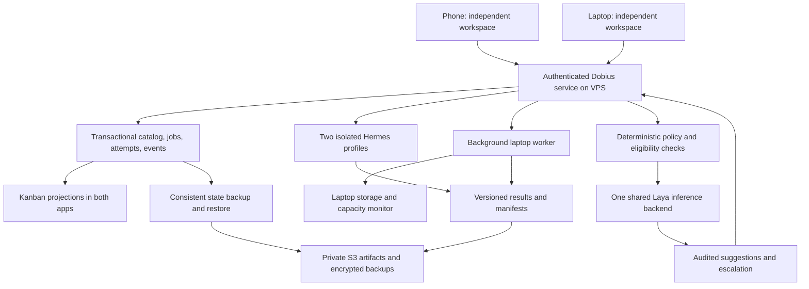

# Dobius cloud workstation, data, and storage build plan

Date: 2026-10-12. Status: planning complete; implementation and live rollout pending.

## Outcome and scope

Dobius laptop and phone become independent workstations connected to one persistent
VPS service. Each app keeps its own workspace and selected tab. Jobs appear in the
existing Kanban and run on an explicitly selected, compatible worker. Two Hermes
agents have separate profiles and worktrees. The laptop handles larger and native
Apple builds without taking over the user's selected terminal. A central data
catalog connects projects, Obsidian notes, jobs, logs, artifacts, and recovery
information. A background laptop service tracks storage and applies approved
cleanup rules. Laya provides evaluated decision advice across those surfaces.

This is a concrete build program for that scope, not a claim that these features
are deployed. The user's stop of the historical external-drive backlog remains
effective. This document does not resume its terminals, modify its queue, launch
agents, provision paid compute, delete files, or activate autonomous execution.
Other projects, OmniRoute, and the live Operations Canvas remain outside scope.
Existing ADAM-related contracts are compatibility inputs, not authority to restart
or rebuild a separate project. User questions flow to ROOT; ROOT searches evidence
and resolves implementation details before requesting missing product decisions.

## Evidence and current baseline

Inspected on October 12:

| Component | Evidence | Remaining work |
| --- | --- | --- |
| Canonical source | `dobius-plus`, branch `fix/channel-cost`, HEAD `a8d6be50` | Preserve existing dirty/untracked work through every integration |
| Installed laptop | Earlier release evidence records desktop 2.0.0/build 15 and AWS settings | Recheck installed/source identity before any future release |
| Phone | User-accepted native 0.0.22/build 2; committed source survives | Physical loading of VPS-served JS and new behavior still need acceptance |
| VPS launcher | `dobius-metro` and `dobius-serve` both active in this inspection | Older running app server compatibility is unverified |
| VPS workspace | `/srv/dobius/workspaces/dobius-plus`; migration documented and committed | Encrypted S3 protection still pending |
| Cloud backup engine | Laptop and VPS both report `waiting_for_configuration` | Credentials, bucket controls, real S3 snapshots and restores |
| Kanban | Existing Vertex task store and IPC-backed board | Shared authoritative API and headless dispatcher |
| Board dispatcher | `board-dispatch.ts` explicitly runs in renderer while a window is open | Preserve channel identity/outbox delivery while moving execution off the UI |
| Workflow history | Existing `SafeJsonFile` workflow run store | Reconcile with durable job/attempt identity; no competing dispatchers |
| Storage analysis | Existing local/SSH workspace analysis and cleanup surfaces | Background whole-volume monitoring and verified eviction rules |
| Phone focus | Phone follows shared active-tab snapshots and sends `terminal.focus` | Independent client selection and reconnect behavior |
| Hermes | Existing `hermes --tui` launch configuration; not found on inspected VPS PATH | Verify installation, provider credentials, profiles and capacity |
| Laya | Fork and MCP contract documented in Obsidian; seed watcher survives | Recover exact fork, pin runtime/model, evaluate and deploy |
| Historical orchestration | `PAUSE` exists; no worker resumed | Keep old queue separate from this proposed product queue |

The laptop has about 9.9 GiB available in this inspection. The VPS has two CPUs
and about 78 GiB available. These are dated measurements, not permanent capacity
or performance guarantees. Two agents plus inference and builds must be measured
alongside Metro, Dobius, speech services, synchronization, and existing workloads.

## One source of truth and storage responsibilities

- The VPS catalog owns Dobius-managed IDs, relationships and job transitions.
  Neither app writes its database or JSON files over a shared filesystem.
- Git owns committed code history. Uncommitted and untracked work receives
  explicit encrypted backup; a Git commit is not its substitute.
- Human-authored Obsidian Markdown remains editable at its declared vault path.
  The catalog indexes it and records provenance; it does not become a second
  editable copy. Existing Syncthing must have one documented sync arrangement.
- S3 holds managed file versions, artifacts and encrypted recovery snapshots.
  Separate artifact and restic prefixes/permissions; never lifecycle-expire
  current restic repository objects. Artifact links carry no embedded credentials.
- Laptop and VPS working directories are execution locations. Pin active projects;
  hydrate inactive managed files on demand into a bounded cache.
- Secrets stay outside the catalog, logs, Git, notes and job payloads. References
  to credentials are allowed; credential values are not.
- New folders and personal libraries are opt-in scope. Inventory identifies
  uncovered folders instead of claiming every laptop file is protected.

Recommend a server-local transactional SQLite store for the new catalog and job
attempts, using the repository's existing SQLite integration where compatible.
Verify its Linux/Node packaging and transaction behavior before committing to it.
Existing board JSON has a different, single-process assumption; do not silently
replace it or let JSON and SQLite both become writable task masters. Preserve task
IDs and import/export originals during a versioned migration. External Git/issue
providers remain authoritative for their own records; link them to Dobius jobs.

Use consistent database backups through the supported backup API/export, not a
copy of an actively changing database file. A restored VPS must recover both
catalog references and the associated files, not merely start with an empty board.

## Source destinations

All paths below are relative to the canonical `dobius-plus` Git root. New domain
folders are proposed; existing ones should be extended before creating parallels.

| Responsibility | Source location |
| --- | --- |
| Shared job, data, policy and decision schemas | `dobius/src/shared/` |
| Durable dispatch and worker adapters | `dobius/src/main/automations/`; focused job modules beneath this domain |
| Board persistence/projection | `dobius/src/main/vertex/`, existing IPC and runtime RPC methods |
| Catalog and migration storage | `dobius/src/main/storage/`; focused `data-catalog/` domain if needed |
| Backup integration | `dobius/src/main/cloud-backup/`, `dobius/config/scripts/cloud-backup/` |
| Background storage service and OS scheduling | `dobius/config/scripts/system-monitor/` (new); typed app adapter in main process |
| Laptop worker bootstrap and OS supervision | `dobius/config/scripts/workstation-worker/` (new); execution logic in main domains |
| Desktop Jobs/Data/System views | Existing Kanban, settings and workspace-cleanup components under `dobius/src/renderer/src/` |
| Phone Jobs/Data/System and client selection | `dobius/mobile/app/`, focused modules under `dobius/mobile/src/` |
| Laya client and decision evidence | Focused `dobius/src/main/decisions/` and schemas in `dobius/src/shared/` |
| Laya backend | Recover/pin the actual Laya fork separately; no Torch/model weights inside Electron/mobile |
| Deployment, verification and release tooling | Existing `scripts/`, `dobius/config/scripts/`, `.github/workflows/` |
| Build documentation | This plan; affected domain runbooks; Obsidian cross-links |

Runtime state belongs outside source. Proposed VPS paths are `/srv/dobius/state/`,
`/srv/dobius/artifacts/`, and `/srv/dobius/workspaces/`. Register permissions and
backup coverage before creating/using them. Laptop services use private Application
Support directories, with platform equivalents for Linux/Windows. Missing or
unmounted roots refuse execution; they never fall back to home or recreate a fake
external-volume directory. Existing dirty runtime changes are preserved and reviewed.

## Work packages and dependency order

Owners below are proposed terminal responsibilities, not active assignments.
Each package requires a frozen source identity, meaningful verification, reviewed
evidence, canonical integration and a runbook before its delivery can be claimed.

| ID | Package | Owner | Independent reviewer | Dependencies |
| --- | --- | --- | --- | --- |
| C00 | Recovery inventory and contracts | ROOT + RESEARCH | FIXER | None |
| C01 | Verified cloud protection | FIXER | RESEARCH | C00 |
| C02 | Catalog and durable queue | BUILD2 | FIXER | C00; C01 before live migration |
| C03 | Independent phone/laptop selection | BUILD1 | RESEARCH | C00 |
| C04 | Background storage monitoring | OVERNIGHT | FIXER | C00 |
| C05 | Laptop/VPS workers and two Hermes profiles | OVERNIGHT | BUILD2 | C02, C04 |
| C06 | Shared Kanban jobs and results | BUILD1 | RESEARCH | C02, C03, C05 |
| C07 | Data ingestion, archive and hydration | FIXER | BUILD2 | C01, C02, C04 |
| C08 | Laya recovery, benchmark and offline evaluation | RESEARCH | ROOT | C00 |
| C09 | Laya advisory integration | BUILD2 | RESEARCH | C02, C04, C06, C07, C08 |
| C10 | Approved automatic policies | FIXER | OVERNIGHT | C05, C07, C09; eligible surfaces only |
| C11 | Recovery drill and both-app delivery | ROOT + OVERNIGHT | RESEARCH | C01–C10 |

### C00 — Inventory, preservation and contracts

Record canonical revision, dirty-file hashes, installed desktop identity, phone
native and served-JS identities, live services, storage paths and remaining
failed-drive gaps. Inspect recovered queue/path/release repairs before adopting
them; a historical PASS is not proof they are integrated in this build.

Define stable project, device, client, workspace, task, job, attempt, artifact and
dataset IDs; supported worker capabilities; authoritative fields; enrolled devices;
path ownership; policy version; backup coverage. Keep UI selection outside shared
workspace state. Existing historical work is imported only as non-executable
records after reconciliation, never auto-dispatched.

**Acceptance:** baseline manifest explains every included root, preserves all
unrelated edits, identifies unknown recovery gaps and permits no external-drive
fallback. API/store contracts and task status migration are reviewed.

### C01 — Connect and prove AWS backups

Use the existing backup engine and desktop settings. Verify bucket
`dobius-backups-020641930035-us-east-2-an`, region `us-east-2`, blocked public
access, ownership, encryption and versioning through authenticated access. Configure
separate limited laptop/VPS identities and repositories; the prepared laptop-only
policy does not grant VPS access. Store recovery passwords separately. Temporary
credentials require a working renewal path before unattended protection is claimed.

Back up Git metadata, dirty/untracked source, Obsidian, app state, recovery evidence,
VPS canonical workspace and consistent catalog exports when C02 exists. Reconcile
exclusions: dependencies are regenerable; release artifacts need explicit coverage.

**Acceptance:** real S3 snapshot from each machine; restore a real project including
Git history and unfinished changes into an isolated directory; compare manifests
and run a relevant check. Prove wrong-key and interrupted/partial backup failures
remain unhealthy. Verify one scheduled invocation, recovery-key custody and coverage.
No archive eviction before these gates. A canary restore alone is insufficient.

### C02 — One catalog and durable execution queue

Implement a headless service using existing runtime RPC, automation and Vertex
boundaries. Preserve Communications identity, signing and outbox semantics when
extracting renderer dispatch; do not just move its call into main and lose messages.

Persist jobs, dependency graph, attempts, claims, leases, device capacity, versioned
transitions, events, evidence and artifact manifests. Separate a user's task from
its potentially multiple execution attempts. Add idempotent submit, transactional
claim, heartbeat, cancellation, resource reservation and version-checked updates.
Clients reconnect using event sequence/cursor and can fetch a current snapshot.

Execution states: queued, waiting_for_worker, running, needs_review, completed,
failed, cancelled, interrupted. Waiting reasons include laptop offline, unsupported
capability, dependency and insufficient space. Lease expiry becomes interrupted
until actual process identity is reconciled; it does not blindly rerun side effects.
Use at-least-once delivery with idempotency and fenced leases, not an impossible
promise of exactly-once arbitrary shell execution. An old worker cannot publish
success after losing its lease. Paid/destructive retries require applicable policy.

**Acceptance:** two clients racing to claim yield one owner; repeated submits do
not duplicate work; stale transitions are refused; kill between claim/start/result
does not lose records; active cancellation handles descendants; paused dispatch
stays paused after restart. Corrupt/unavailable storage refuses writes. Existing
tasks import/export with IDs, notes, order and relationships intact. Both old and
new dispatchers cannot run simultaneously during cutover.

### C03 — Independent workstations

Persist selected host/workspace/tab per client. Shared snapshots expose available
resources without overriding selection. Replace unintended phone `terminal.focus`
coupling while retaining deliberate terminal input ownership and viewport fitting.
Background jobs address a stable session/handle and never the currently selected tab.

**Acceptance:** laptop switching tabs does not move the phone; phone selection does
not move the laptop; reconnect preserves a valid selection; a closed tab produces
an explicit choice/recovery state. Concurrent typing and viewport ownership remain
correct. Unsaved phone drafts survive host-tab removal and reconnect. Verify on the
installed native 0.0.22/build 2 client; a simulator is supplemental evidence.

### C04 — Background laptop storage monitor

Run lightweight free-space sampling independently of the Electron window; publish
timestamped device health to the VPS. Inventory only registered roots, with bounded,
incremental directory scans and clear permission-denied/partial states. Distinguish
logical file sizes, allocated bytes and actual shared APFS volume free space;
folder totals are not guaranteed reclaimable space. Respect symlinks, mounts,
hardlinks, permissions, active worktree leases and pinned files.

Proposed editable defaults: sample free space every minute; warn below the larger
of 20 GiB or 15% of capacity; critical below the larger of 10 GiB or 8%; recover
only above a hysteresis band. These are starting policy settings, not universal
build requirements. Include per-job estimated working space, reserved concurrent
space and a safety margin in admission; unknown estimates use conservative policy.
Publish low-space alerts, top registered consumers, trends and cleanup receipts.
Suspend/archive scans must not starve terminal responsiveness or a backup restore.

**Acceptance:** simulated low disk blocks a space-heavy job before launch; noisy
threshold crossings do not spam alerts; closed app still samples; sleeping/offline
laptop displays stale data, not healthy. Low-space fixtures do not fill the real
disk. Permission errors/unmounted paths do not trigger deletion. Windows/Linux
adapters are tested or explicitly reported unsupported; no silent macOS assumptions.

### C05 — Workers and isolated Hermes agents

Enroll one background laptop worker and VPS workers over authenticated private
transport. Reuse existing local/SSH providers and capability detection. Apple
signing/iOS-native jobs require a Mac; Linux-compatible jobs may use the VPS.
Offline laptop jobs remain waiting; wake/reconnect does not duplicate them.

Create two distinct Hermes profiles and exclusive worktrees, after validating
provider auth and the supported launch/resume contract. Preserve agent session IDs,
task/context provenance and checkpoints. A profile is not shared by live processes.
Agent permissions are limited to registered roots and job capabilities; no blanket
auto-approval. Resource control applies to entire process trees, not just parents.

Measure RAM/CPU with Metro and existing services. Start with one heavy build at a
time; two available agents do not mean two heavy builds. Cap model calls,
attempts, output size, timeouts and spend using existing provider controls. Report
estimated vs actual spend; an SDK budget trigger may not be a strict billing ceiling.

**Acceptance:** phone submits a laptop-targeted build, laptop sleeps/disconnects,
job waits, reconnect executes in background and returns attributable logs/results.
Two agents do small disjoint tasks without profile/source collisions. Restart
reconciles persisted PID plus start/session identity. An offline/disallowed worker
cannot claim; cancellation stops owned descendants; user-selected tabs are unchanged.

### C06 — Kanban is the job surface

Extend the existing board; do not create another queue app. Show Queued, Waiting,
Running, Needs review, Done and Failed, with cancelled/interrupted history preserved.
Map existing backlog/todo/in-progress/blocked/review/testing/done semantics explicitly
instead of rewriting user columns. Waiting cards show reasons such as laptop offline.

Cards display requesting workspace, target, agent, attempt, dependencies, timestamps,
logs, source revision, artifacts and verification. Queuing/assigning distinguishes
draft work from authorization to spend. Retry/cancel are explicit version-checked
commands. Agent exit 0 moves to review; mandatory checks and required acceptance
must pass before Done. Manual board movement cannot fabricate verification.

**Acceptance:** both apps see identical job identity and lifecycle; duplicate and
out-of-order events converge; reconnect catches missed updates; logs/results remain
accessible after app closure. Existing tasks and non-job cards still work. Failed
jobs cannot look completed. Neither opening Jobs nor an event changes a terminal tab.

### C07 — File catalog, Obsidian, archive and on-demand restore

Connect registered projects, vaults and artifact locations to catalog entries with
content/version identity, authoritative location, coverage, source job and audit
trail. Use incremental ingestion, conflict detection, resumable uploads, checksum
verification and visible partial/error states. Unknown files remain uncovered.

Keep human notes intact. Start with search and links to originals, backed-up versions
and suggested relationships. Jobs link source revision, run manifest, logs and
outputs. Separate working objects from encrypted recovery snapshots and restore
into a new directory before replacing anything.

Archive flow: lock/version-check eligible inactive item -> upload or locate exact
backed-up version -> verify checksum and applicable restore path -> record durable
receipt -> remove only the approved local copy -> retain a catalog entry -> hydrate
on demand. Crash recovery must preserve either the local original or verified remote
copy. A file edited after upload invalidates eviction eligibility. Dirty/untracked
Git work, pinned projects and active leases are not automatic eviction candidates.

**Acceptance:** large transfer resumes, corrupt upload refuses eviction, offline
hydration explains waiting, changed source refuses stale deletion, conflicting note
edits preserve both versions. Full project hydration reproduces tracked and relevant
untracked content. Cache bounds apply on both hosts; artifact manifests survive a
catalog restore. Permission-restricted paths do not leak through search or downloads.

### C08 — Recover and evaluate Laya before live decisions

Use the previously documented fork `https://github.com/aiimitch38-create/laya` as
the recovery candidate. Historical revision was `3cf26cbcb18725dbc2d127bb8bb2c4c43243ae63`.
The failed-drive clone is not available; inspect remote history, differences and
license before choosing a pinned revision. Do not replace custom fork changes with
upstream latest by accident. Pin Python, dependencies, selected checkpoint revision
and schema versions. Avoid putting a model cache back on the laptop's nearly full disk.

Build a sanitized, versioned corpus of terminal tails, job descriptions and data
metadata. Include noisy success logs containing the word error, quiet long-running
builds, missing evidence, ambiguous ownership and permission prompts. Separate
training/tuning and held-out evaluation; compare deterministic baseline vs Laya.
Measure per-surface precision, recall, abstention, calibration, latency and memory;
reported confidence is not proof of correctness. Long-input truncation must be visible.

A single `laya-serve` inference backend is shared. Each MCP client uses a lightweight
stdio adapter with `LAYA_BASE_URL`; the stdio process itself is not a shared network
server. Keep backend loopback/private and authenticated, with secrets supplied from
private runtime storage. Select/check CPU runtime support on the actual VPS. Start
with one measured checkpoint and bounded threads, avoiding unmeasured multi-model
preload. No GPU/EC2 spending is inferred. Benchmark alongside live Metro health.

**Acceptance:** two MCP clients use one backend with no weights/Torch loaded in the
adapters; missing/wrong authentication fails; outage/timeout returns unavailable;
resource load remains within the service budget. Save a reproducible held-out report
and per-surface thresholds. Offline evaluation may proceed before queue delivery;
live advisory wiring waits for foundation acceptance. No advertised millisecond
latency is accepted as measured VPS performance.

### C09 — Add Laya advice to the shared service

Laya receives bounded, redacted evidence through a server-side client. Responses
are validated enums/scores/probabilities, with an abstain option. Persist decision
ID, input digest, evidence references, checkpoint/schema/policy version, confidence,
timing, selected suggestion, actual action and later reviewer correction.

| Surface | Laya contribution | Deterministic authority |
| --- | --- | --- |
| Job routing | Suggest a suitable role or target from eligible choices | Capability, permissions, disk/RAM, dependencies, user target |
| Kanban | Suggest priority, blocker category or retry investigation | Actual job events and verified state transitions |
| Agents | Flag ambiguous stuck/needs-attention output | Process identity, heartbeat, exit codes, explicit permission gates |
| Data | Suggest tags, relationships and archive candidates | Ownership, pinned/dirty state, exact versions and recovery receipts |
| Storage | Rank already-safe cleanup candidates | Free-space readings and approved allowlists |
| Verification | Escalate suspicious or incomplete evidence | Test results, artifact identity and required acceptance |

Use event-driven incremental inputs, batching, quotas and backpressure rather than
repeatedly asking a large model about unchanged logs. Cache exact-input results only
for read-only hints. Laya cannot override failed tests, grant permission, prove a
backup, mark Done, authorize deletion or suppress mandatory review. Failure falls
back to deterministic behavior or abstention; the queue remains usable without it.
Start in shadow mode, then suggestions. Generative agents explain or investigate
ambiguity; Laya's typed result alone does not provide a reliable prose explanation.

**Acceptance:** missing/low-confidence/malformed responses leave hard behavior
intact; stale model/schema results cannot drive actions; prompt-like text in logs
cannot gain permissions; no raw private notes or secrets are transmitted implicitly.
Read back evidence in both apps. Verify actual classifier suggestions against held-out
labels and user corrections before promoting any individual surface to automation.

### C10 — Policy-controlled automation

Expose rules in Settings: monitored roots, pinned projects, cache quotas, low-space
thresholds, permitted cleanup classes, archive age/size, worker limits and notifications.
Provide a dry run with exact candidate paths, reason and expected space; retain a
receipt for every action. Only approved disposable cache classes auto-clean initially;
skip shared dependency stores and running jobs unless their specific semantics are
proved safe. Original-file eviction requires C01/C07 verification and explicit rules.

Policies are enforced server/worker-side, outside Laya. Recheck eligibility at action
time to prevent path replacement/symlink races. Pause disables future actions across
restarts; show the status of an action already underway. Offline data decisions queue
until the required checks are possible. Destructive rules are never learned silently.

**Acceptance:** rules survive restart; dry run and execution agree on frozen versions;
source mutations refuse stale actions; low disk does not trigger unsafe cleanup;
failure preserves evidence and originals; pause stops future dispatch. Staging tests
exercise actual temporary filesystem data without deleting personal files.

### C11 — End-to-end recovery and delivery

Test the whole path: phone -> Kanban -> VPS claim -> laptop build -> artifact upload
-> verification -> review -> accepted result. Repeat with phone closed, laptop sleep,
worker crash, VPS restart, Laya outage, S3 denial, expired credentials, full-disk
simulation, duplicate events, cancellation and network interruption.

Restore the VPS catalog and a real project into an isolated environment using only
documented recovery material. Resolve restored in-flight jobs before enabling the
dispatcher. Restore must not replay irreversible actions or require the failed drive.
Check both apps' terminal selection throughout. Review device access revocation,
secret redaction, artifact permissions, backup freshness and dependency risk.

Build from the canonical integrated source with pinned toolchains. Desktop installation
uses `pnpm --dir dobius run build:unpack` and the existing gated installer, following
`RELEASING.md`. Do not bypass signing/source identity/rollback gates. Keep phone native
0.0.22/build 2 unless a concrete native requirement is separately resolved; JS changes
still require compatibility and physical acceptance. Verify VPS running artifact,
service units and source revision, not merely the checkout. Preserve Metro operation.

**Acceptance:** exact source/artifact identities, reviewed test commands and exit
codes, installed laptop verification, physical phone acceptance, restored data,
rollback rehearsal and runbooks. Code written, reviewed, integrated, deployed and
accepted are distinct evidence states. A blocked live credential/device check remains
open; no final everything-done claim while a required gate is missing.

## Practical execution workflow

1. ROOT freezes C00, records dependencies and preserves dirty work. Confirm actual
   worker session/cwd/branch/idle status before any later authorized assignment.
2. Initial independent packages: C01 backup, C03 client selection, C04 monitor,
   C08 Laya evaluation; BUILD2 designs C02 against the reviewed contract. Local
   fixtures can proceed without AWS keys; live backup/migration waits for them.
3. Integrate C02, then C05/C06. C07 uses verified backups and monitoring. Only then
   wire C09 and promote independently eligible C10 rules.
4. ROOT owns serial canonical integration and C11 release. No worker restarts live
   services, updates the served workspace, installs apps or pushes without the
   corresponding concrete rollout scope. The old stopped queue remains stopped.

Each package record: ID, owner, reviewer, dependencies, repo/branch/base, permitted
files, next action, acceptance criteria, blockers, source/diff hashes, test evidence,
integration commit, deployment identity and actual acceptance. A review refers to an
exact frozen diff; changing that diff requires another review.

Keep one heavy build at a time initially. Parallelize disjoint small modules/reviews,
not shared database migrations, package installation, Git mutations or live rollout.
When small delegated experiments are authorized, use narrow tasks such as reviewing
a lease-race fixture or a redaction corpus. Measure cost and correctness; the owner
remains responsible for integrating and verifying the result. This plan launches none.

## Verification and operations documentation

Use existing test runners and realistic temporary fixtures. Relevant existing suites
include Vertex store/dispatch, workflow history, automation admission, cloud backup,
workspace-space analysis, mobile session snapshots and terminal ownership. Add tests
for new failure behavior; do not mirror implementation or weaken stale assertions.

Required checks for affected implementation: desktop Node/CLI/renderer typechecks,
scoped Vitest plus relevant integration suites, mobile Vitest and TypeScript checks,
Python backup/monitor tests, lint/localization/style checks, Electron UI verification,
Linux service integration and physical phone acceptance. Establish dependency/toolchain
availability first and classify environment failure as NONPASS. No heavy application
tests are needed merely to validate this documentation-only change.

Ship runbooks for enrollment/authentication and revocation; queue claims/recovery;
backup/key recovery; data conflicts/archive/hydration; storage rules and pause;
Hermes profile/worktree recovery; Laya model/schema rollback; desktop/VPS release
rollback. Health displays freshness and separate backup/restore timestamps. Proposed
targets to validate: health reaches either app within one sampling interval while
connected; queue events reach connected clients within five seconds; configured
backup interval is 30 minutes while online; measured worst-case job storage estimates
include a safety margin. These are acceptance targets, not current guarantees.

## References and unresolved inputs

- Existing source: `dobius/AGENTS.md`, `dobius/docs/STYLEGUIDE.md`, `RELEASING.md`,
  board dispatch/Vertex stores, workflows, backup README and mobile session code.
- Existing Obsidian: *Dobius Cloud Workspace Assessment 2026-10-12*, *Dobius Automatic
  Cloud Backups 2026-10-12*, *Dobius Phone Launcher VPS Migration 2026-10-12*,
  *Laya Decision Engine*, and the October 8 MCP handoff. Older external-drive paths,
  hardware/cache guidance and ownership instructions are historical, not live setup.
- [Laya source and shared MCP backend contract](https://github.com/NandhaKishorM/laya#mcp-server-optional)
- [Hermes isolated profiles](https://hermes-agent.nousresearch.com/docs/user-guide/profiles)
- [SQLite consistent backup API](https://www.sqlite.org/backup.html)
- [S3 versioning](https://docs.aws.amazon.com/AmazonS3/latest/userguide/Versioning.html)

Before the dependent live step: obtain restricted AWS credentials through the existing
private setup, confirm recoverable Laya fork changes, verify Hermes provider auth,
choose a model/spend limit where not already configured, and obtain handset acceptance.
Exact capacity, inference latency and archive eligibility come from measurements and
tests. No new cloud compute purchase or expansion to unrelated personal folders is
assumed. The first execution milestone is C00/C01 verified recovery, not cleanup.

### 2026-10-13 21:15 EDT — exact source review checkpoint

C09 coherent-authority correction (15 files, aggregate `7d66f72310e209dcbd9cb7ea20683d5d1a1533301e775cc5cdf708f4cbfa8ac7`) has ROOT source acceptance and independent FIXER PASS with 52 focused tests. Full Node, CLI, and renderer TypeScript checks passed on Node24. The advisory feature remains unavailable until a production epoch adapter, participating writers, provider, and quality evaluation are wired; this is not live inference acceptance.

Release resource freeze872df246 was reopened: a temporary FIFO helper blocked validation before regular-file rejection. ROOT preserved a bounded reproduction and assigned nonblocking descriptor validation/regressions to BUILD2; RESEARCH is reviewing the remaining contract. No app installed or restarted. ADAM audit documents remain peer-PASS; existing integration is distinct from unfinished workstation/ADAM wiring. VPS speech/serve/Metro remain active; all private Linux full-build attempts are nonpassing due to memory constraints. The request to pause live speech temporarily remains unanswered; no pause occurred. AWS remains user-deferred and historical Storage queue paused.

### Final release source acceptance — 2026-10-13

Release helper/ASAR contract final aggregate72094926 has ROOT and RESEARCH source PASS. All24 focused Python regressions passed, broader88 installer/provenance/version/docs checks passed, and the actual installed legacy bundle remains rollback-eligible. Parent traversal, whole-graph budgets, FIFO refusal, pinned archive payloads, malformed root/nested graph refusal, and descriptor cleanup were verified. Previous failing snapshots remain preserved. All workers are holding source/reports for fresh recovery capture and the canonical local build; no installation has happened yet. VPS live services remain unchanged and speech-pause approval is still pending. AWS deferred; historical Storage queue paused.

### 2026-10-14T01:31:28.324106+00:00 — canonical desktop checkpoint installed

Dobius+2.0.0/build17 is installed through the gated installer. The complete typecheck/relay/Electron/web/CLI/native/package/sign graph passed; artifact/signature/provenance gates passed before and after installation. Both packaged catalog helpers match accepted source. All five Dobius sessions preserved exact PTY/tab/leaf identity and remain connected/writable; handles were rebound for runtime `993d5ed8-6063-41c1-9007-04ad74b81cc4`. Live catalog lists0 explicitly enrolled roots and denies a test unregistered root with0 entries scanned. Monitor is available/fresh/critical with cleanup disabled; live job authority is unconfigured and dispatch remains disabled. Stale-runtime send was refused with0 bytes.

Fresh private VPS source checkpoint `/srv/dobius/recovery/source-checkpoint-1791940919` restored285 modified/untracked source files with no hash mismatches and24 release regressions passed on Linux. This covers source/plans, not personal vault/app state/credentials/dependencies/native artifacts or automatic AWS protection.

Remaining: complete VPS artifact/deployment (RAM limit; speech pause approval pending); phone physical/UI acceptance (device is paired but developer disk image lacks its variant); queue/QueuePort/Hermes live enrollment/dispatch; real Laya provider/epoch/evaluation; explicit original-note preview; new ADAM workstation bridge implementation. ADAM audit docs are complete/peer-PASS, not proof of these live connections. AWS is deferred, historical Storage queue paused, other projects excluded.

### October 14 reviewed preview and two-worker checkpoint

Desktop/shared and phone preview privacy regressions now pass independent review, including visible-state generation switches before passive cleanup. Native helper, backend, and exact-connection event router reviews pass at their current frozen identities. The two-slot Hermes supervisor invocation race is corrected and independently reviewed. ROOT added the single-store host callbacks and private decrypted journal lease observation; 38 real SQLite/encryption/worker tests pass and the nine-file slice passed independent review. These pieces are not yet a live enrolled Hermes executor. Desktop/VPS packaging is the next acceptance step; AWS remains deferred and the old Storage queue remains paused. Version remains 2.0.0 for checkpoints, with 2.1.0 reserved for the completed feature release.

### Packaged startup correction after checkpoint 18

Build 18 passed artifact and signature gates but failed live acceptance: sandboxed preload attempted an external Zod require. The healthy build 17 was restored; the exact hung main process was stopped while the detached daemon and all five existing worker sessions survived. ROOT now inlines Zod and validates emitted preload module loading, with 14 source regressions and independent review. Fresh non-incremental checks uncovered two missing web compatibility APIs; corrected web preview and native resume remain explicitly unavailable, with 61 independent tests. The installer now refuses exit 10 if the main process survives or its exit cannot be verified; 17 independent fixtures cover preservation and command-line arguments. Fresh full Node/CLI/renderer checks pass. Build 19 packaging and real sandbox acceptance remain pending. Linux capture 357 is verified source, but its build failed the fresh web check and produced no deliverable artifact. AWS remains deferred and the historical Storage queue remains paused.
